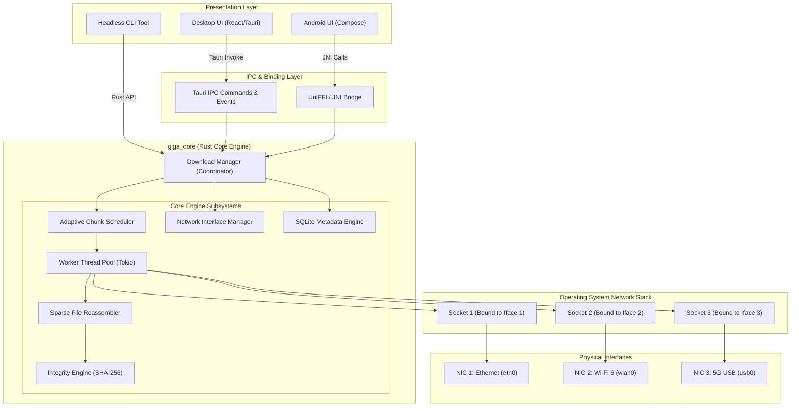
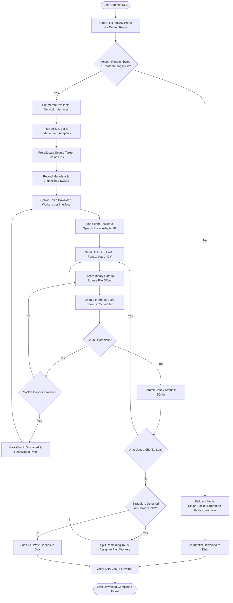
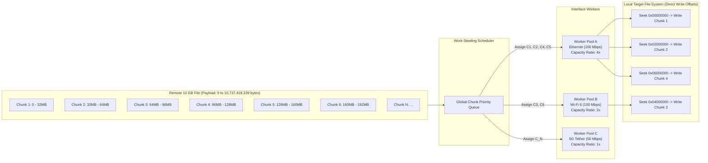
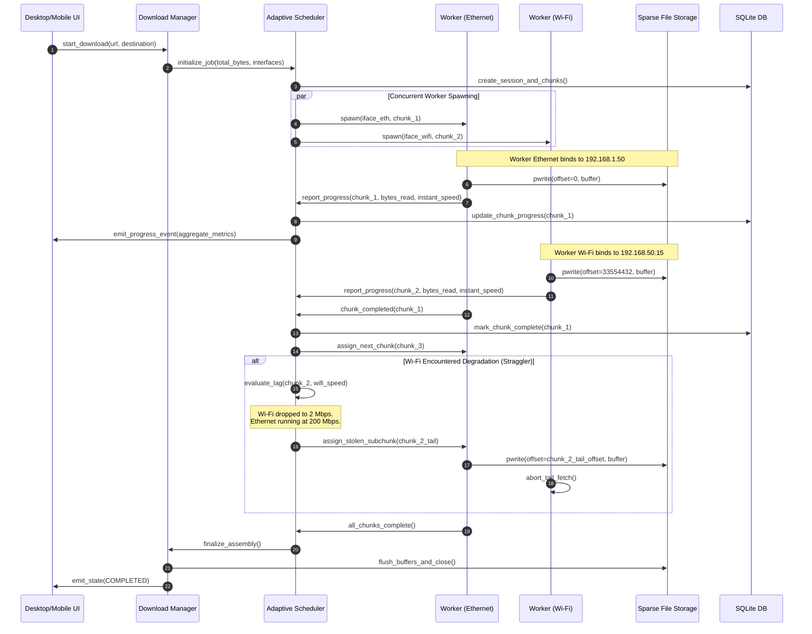
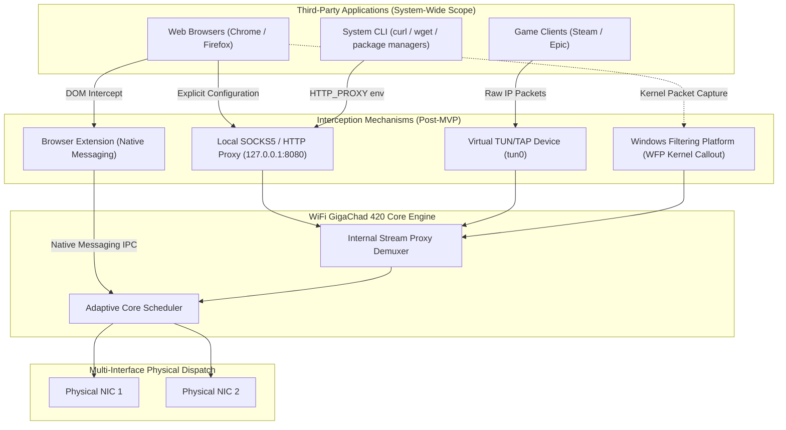
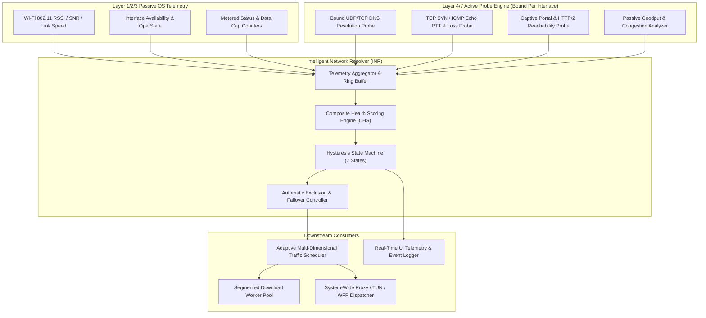
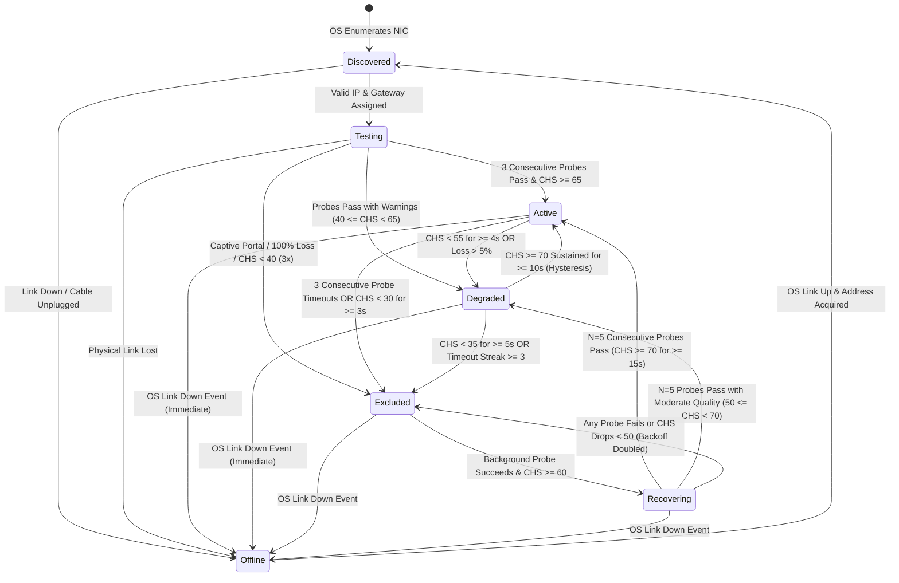
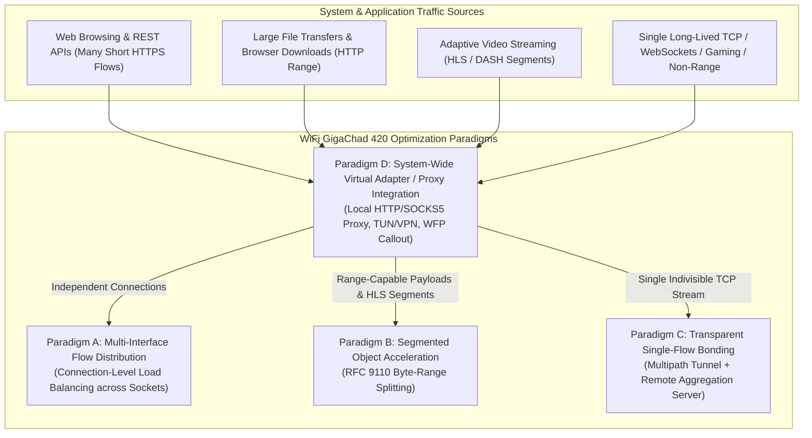
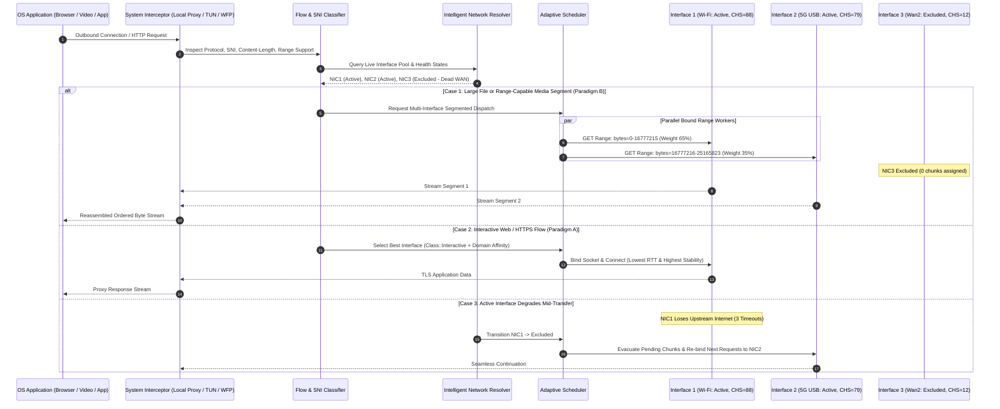

# WiFi GigaChad 420: Technical Project Blueprint & Architecture Specification

**Document Version:** 1.0.0  
**Status:** Approved Architectural Specification  
**Authors:** Principal Systems Software Engineer, Network Engineer, Rust Architect, Cross-Platform Lead  
**Target Delivery:** Multi-Platform Download Acceleration Engine (Desktop & Mobile)  
**Primary Repository:** `cubicreates/WifiGigaChad420`  

---

## Executive Summary

**WiFi GigaChad 420** is an open-source, high-performance, cross-platform download acceleration application designed to aggregate bandwidth across multiple independent network interfaces (e.g., dual Wi-Fi adapters, Ethernet, cellular USB tethering, 4G/5G mobile modems). By decomposing large downloadable assets into dynamic byte ranges via HTTP Range Requests (RFC 9110) and dispatching concurrent download workers bound specifically to distinct physical and logical network adapters, the system drastically reduces file transfer durations without requiring modifications to remote origin servers.

This document serves as the master engineering specification, technical blueprint, and development roadmap. It establishes the architectural foundations, scheduling algorithms, operating system socket-binding models, database schema, security mitigations, and implementation milestones required to execute the project from MVP to production readiness.

---

## 1. PROJECT OVERVIEW

### 1.1 Project Identity
* **Official Name:** WiFi GigaChad 420
* **System Binary:** `gigachad-core` (Headless Daemon / Shared Library)
* **Desktop Distribution:** `gigachad-desktop` (Tauri 2 / React)
* **Mobile Distribution:** `gigachad-android` (Kotlin / Jetpack Compose)

### 1.2 Core Engineering Concept

In standard operating system networking stacks, the kernel's routing table directs all outbound unicast traffic for an arbitrary destination IP through a single default gateway determined by interface metrics (lowest metric wins). Consequently, even if a host possesses multiple operational network adapters (e.g., Gigabit Ethernet, onboard Wi-Fi 6, and a USB 5G modem), a standard TCP connection or HTTP download utilizes only one physical interface at any given instant. The aggregate bandwidth of the secondary and tertiary interfaces remains entirely unutilized.

WiFi GigaChad 420 bypasses the default operating system routing behavior by explicitly binding TCP/IP client sockets to specific local network interface IP addresses or interface indices prior to issuing outbound connection handshakes (`connect()`).

```
                    ┌────────────────────────────────────────────────────────┐
                    │               Remote HTTP Origin Server                │
                    │               (Supports RFC 9110 Range)                │
                    └───────────────────────────┬────────────────────────────┘
                                                │
                     Public Internet / Diverse ISP Routing Paths
                                                │
         ┌──────────────────────────────┼──────────────────────────────┐
         │ (Path A)                     │ (Path B)                     │ (Path C)
         ▼                              ▼                              ▼
┌──────────────────┐           ┌──────────────────┐           ┌──────────────────┐
│  ISP 1 (Fiber)   │           │ ISP 2 (Starlink) │           │ ISP 3 (5G LTE)   │
│ 200 Mbps Uplink  │           │ 100 Mbps Uplink  │           │  50 Mbps Uplink  │
└────────┬─────────┘           └────────┬─────────┘           └────────┬─────────┘
         │                              │                              │
┌────────▼─────────┐           ┌────────▼─────────┐           ┌────────▼─────────┐
│ Ethernet Adapter │           │  Wi-Fi Adapter   │           │  USB Tethering   │
│  (eth0 / en0)    │           │ (wlan0 / wlan1)  │           │  (usb0 / rndis0) │
└────────┬─────────┘           └────────┬─────────┘           └────────┬─────────┘
         │ IP: 192.168.1.50             │ IP: 192.168.2.110            │ IP: 192.168.42.15
         │                              │                              │
         │ bind(192.168.1.50)           │ bind(192.168.2.110)          │ bind(192.168.42.15)
         │ Workers: 1, 4, 7             │ Workers: 2, 5                │ Workers: 3, 6
         └──────────────────────────────┼──────────────────────────────┘
                                        │
                 ┌──────────────────────▼──────────────────────┐
                 │       WiFi GigaChad 420 Engine              │
                 │   - Adaptive Work-Stealing Scheduler        │
                 │   - Pre-Allocated Sparse File Assembler     │
                 │   - SHA-256 Incremental Checksummer         │
                 └─────────────────────────────────────────────┘
```

The system:
1. Discovers and catalogs all operational, connected physical network adapters.
2. Performs connectivity, RTT (Round Trip Time), and gateway independence diagnostics.
3. Queries the remote file resource using an HTTP `HEAD` or ranged `GET` probe to verify:
   - Resource existence (`HTTP 200` or `HTTP 206`).
   - `Accept-Ranges: bytes` support.
   - Total payload dimensions (`Content-Length`).
   - Cache control and entity consistency identifiers (`ETag`, `Last-Modified`).
4. Calculates a partitioned chunk topology across available interfaces based on real-time empirical link capacity.
5. Spawns asynchronous worker loops where each worker's client socket is explicitly bound to a selected physical interface.
6. Writes inbound binary byte buffers asynchronously into non-overlapping offsets of a pre-allocated sparse target file on persistent storage.
7. Continuously monitors worker throughput via Exponential Moving Averages (EMA) and dynamically rebalances or steals remaining chunks from lagging interfaces.
8. Reassembles, flushes disk buffers, and executes an end-to-end cryptographic integrity verification (SHA-256).

### 1.3 Critical Physics & ISP Constraints: The Bandwidth Fallacy

> [!IMPORTANT]
> **WiFi GigaChad 420 DOES NOT magically multiply the physical capacity of a single Internet Service Provider (ISP) subscription.**

* **The Shared Last-Mile Constraint:** If an Ethernet port and a Wi-Fi card are both connected to the same residential gateway/router, both interfaces share the exact same upstream broadband link (e.g., a single 300 Mbps cable modem). Utilizing both interfaces concurrently across the local LAN will simply divide the 300 Mbps between them (e.g., 180 Mbps on Ethernet + 120 Mbps on Wi-Fi = 300 Mbps total), producing zero net throughput gain while increasing TCP contention and local CPU overhead.
* **Genuinely Independent Networks:** True acceleration requires **multihomed physical paths**. For example:
  - Connection A: Fiber Broadband via Ethernet (`eth0`).
  - Connection B: Cellular 5G hotspot via Wi-Fi (`wlan0`).
  - Connection C: Neighboring independent VDSL Wi-Fi via USB Wi-Fi dongle (`wlan1`).
* **Server-Side Bottlenecks:** Throughput is strictly bounded by `min(Aggregate_Client_Bandwidth, Server_Egress_Capacity, Per_IP_Rate_Limit * Interface_Count)`. If an origin server caps single IP streams to 10 Mbps, utilizing 3 independent network interfaces with 3 unique public IPs legitimately bypasses the per-IP throttle, yielding 30 Mbps.

### 1.4 Detailed Mathematical Acceleration Model

Consider a 10 GB ($10 \times 10^9$ bytes $\approx 9,536.74\text{ MiB}$) distribution:

| Interface Identifier | Physical Medium | Local IP Address | Measured Goodput ($B_i$) | Latency (RTT) | Target Allocation ($R_i$) |
| :--- | :--- | :--- | :--- | :--- | :--- |
| **Interface 1 (`if0`)** | Gigabit Ethernet | `192.168.1.10` | 200 Mbps (25.0 MB/s) | 12 ms | 57.14% (~5.71 GB) |
| **Interface 2 (`if1`)** | 5 GHz Wi-Fi 6 | `192.168.50.15`| 100 Mbps (12.5 MB/s) | 28 ms | 28.57% (~2.86 GB) |
| **Interface 3 (`if2`)** | 4G LTE USB Modem| `192.168.8.100` | 50 Mbps (6.25 MB/s)  | 65 ms | 14.29% (~1.43 GB) |

$$\text{Aggregate Theoretical Bandwidth } B_{\text{total}} = \sum_{i=1}^{N} B_i = 200 + 100 + 50 = 350\text{ Mbps } (43.75\text{ MB/s})$$

$$\text{Theoretical Duration } T_{\text{optimal}} = \frac{10,000\text{ MB}}{43.75\text{ MB/s}} \approx 228.57\text{ seconds } (\sim 3.81\text{ minutes})$$

Compared against single-interface execution:
* Ethernet alone: $\frac{10,000\text{ MB}}{25.0\text{ MB/s}} = 400.0\text{ seconds } (\sim 6.67\text{ minutes})$ $\rightarrow$ **$1.75\times$ Speedup**
* Wi-Fi alone: $\frac{10,000\text{ MB}}{12.5\text{ MB/s}} = 800.0\text{ seconds } (\sim 13.33\text{ minutes})$ $\rightarrow$ **$3.50\times$ Speedup**

Accounting for real-world protocol overhead ($\eta \approx 0.94$ due to TCP slow-start, TLS renegotiation, chunk boundary scheduling delay, and sparse disk I/O):
$$T_{\text{practical}} = \frac{T_{\text{optimal}}}{\eta} \approx \frac{228.57}{0.94} \approx 243.16\text{ seconds } (\sim 4.05\text{ minutes})$$

---

## 2. PROJECT VISION

The project roadmap spans from a dedicated download manager to an autonomous, cross-platform traffic bonding subsystem.

### 2.1 Scope Stratification

```
+-------------------------------------------------------------------------------+
| PHASE 3: System-Wide Remote Bonding & Kernel Interception (Future Vision)     |
| - WFP (Windows) & eBPF/TUN (Linux) packet diversion                           |
| - Multipath UDP/QUIC tunneling to remote aggregation VPS                      |
| - Transparent acceleration for arbitrary TCP streams (Steam, games, browsers) |
+-------------------------------------------------------------------------------+
                                      ▲
                                      │
+-------------------------------------------------------------------------------+
| PHASE 2: Application-Specific Local Proxy & Browser Integration (Mid-Term)    |
| - Local SOCKS5 / HTTP Forward Proxy (127.0.0.1:8080)                          |
| - Browser Extension (Native Messaging API) for automated URL interception     |
| - Android VpnService local loopback proxy                                      |
+-------------------------------------------------------------------------------+
                                      ▲
                                      │
+-------------------------------------------------------------------------------+
| PHASE 1: Direct File Download Acceleration MVP (Immediate Scope)              |
| - Explicit URL submission via Desktop UI / Android UI / Headless CLI          |
| - Core Engine in Rust with per-socket interface binding                       |
| - Dynamic chunk scheduler, sparse file assembly, and SHA-256 verification     |
+-------------------------------------------------------------------------------+
```

### 2.2 Core Deliverables Matrix

| Capability | Phase 1 (MVP) | Phase 2 (Mid-Term) | Phase 3 (Vision) |
| :--- | :--- | :--- | :--- |
| **Download Input** | Manual URL / Batch Queue | Browser Extension / Clipboard Hook | Transparent OS Capture |
| **Protocol Support**| HTTP/1.1, HTTP/2 (RFC 9110 Range)| HTTPS, WebSockets | Arbitrary TCP / UDP |
| **Target Platforms**| Windows 10/11, Linux (x86_64) | Android 12+ (ARM64), macOS | Embedded Routers (OpenWrt) |
| **Networking Model**| Layer 4 Socket Binding (`bind`)| Local Forward Proxy Loopback | Remote Tunnel Aggregation Proxy |
| **Privilege Requirements**| Standard User (Desktop) | Standard User (VpnService on Android)| Admin / Root / Kernel Drivers |
| **Infrastructure** | Fully Client-Side (Zero Server Cost)| Client-Side Localhost Proxy | Hosted VPS Aggregator (WireGuard/MPTCP) |

---

## 3. TECH STACK

### 3.1 Shared Core Engine

The engine is engineered as a standalone, headless library (`giga_core`) written in Rust.

| Component | Selected Library | Architectural Purpose | Advantages | Limitations | Viable Alternatives |
| :--- | :--- | :--- | :--- | :--- | :--- |
| **Language** | **Rust (2021 Edition)** | Core system, networking, memory management, file I/O | Zero-cost abstractions, memory safety without GC, deterministic resource reclamation, C-ABI interoperability | Steep learning curve, strict borrow checker constraints in complex async loops | Modern C++ (C++20), Go |
| **Async Runtime** | **Tokio (`rt-multi-thread`)** | Task scheduling, async I/O, timers, concurrency primitives | Industry-standard async runtime, highly optimized work-stealing threadpool, cross-platform OS event polling (`mio` / epoll / kqueue / IOCP) | Runtime footprint (~500KB), cannot easily mix async runtimes within same process | `async-std`, `smol` |
| **HTTP Client** | **Reqwest & Hyper** | HTTP protocol negotiation, TLS handshake, header parsing | Highly optimized, connection pooling, native streaming, supports rustls and native-tls | Reqwest does not expose socket-binding per connection cleanly without custom Hyper connectors | Pure `hyper` + `socket2` custom connector |
| **Socket Control** | **`socket2`** | Low-level OS socket manipulation before connection establishment | Enables explicit binding to local IPv4/IPv6 addresses and interface indices (`SO_BINDTODEVICE`) | Requires OS-specific `cfg` branching | Direct libc / Winsock FFI bindings |
| **Buffer Management** | **`bytes::Bytes` & `BytesMut`** | Zero-copy buffer slicing, circular worker queues | Reference-counted memory blocks, minimal heap allocation churn | Requires strict discipline to prevent buffer fragmentation under heavy load | Pre-allocated arena allocators (`bumpalo`) |
| **Serialization** | **`serde` & `serde_json`** | State serialization, IPC transport, configuration management | Compile-time derive macros, minimal runtime overhead, zero-allocation deserialization | Schema migrations must be handled programmatically | `bincode`, `rkyv` |
| **Persistence** | **SQLite via `rusqlite`** | Task state, completed chunk manifests, interface health history | ACID guarantees, single-file relational database, zero standalone daemon required | Contention under massive write loads if WAL mode is not configured | `sled`, `redb`, LMDB |
| **Cryptography** | **`sha2` & `ring`** | Chunk hashing and end-to-end payload checksumming | SIMD-accelerated SHA-256 computation, constant-time validation | CPU intensive at gigabit throughput if not multithreaded | `blake3` (faster, but origins provide SHA-256) |
| **Observability** | **`tracing` & `tracing-subscriber`** | Structured diagnostics, telemetry, performance profiling | Zero overhead when disabled, async-aware span propagation across tasks | Can generate large log volumes if tracing levels are misconfigured | `log` + `env_logger` |
| **Cross-Language FFI**| **Mozilla `UniFFI`** | Cross-compiling Rust core to Kotlin/Android and Swift/iOS | Generates type-safe bindings across languages from a single UDL/macro definition | Requires build-time code generation pipeline | Raw JNI / C-ABI headers |

### 3.2 Desktop Application Framework

* **Framework:** **Tauri 2 (Release Candidate / Stable)**
* **Frontend:** React 19, TypeScript 5, Vite, Tailwind CSS 4, Lucide Icons.
* **Architectural Justification (Tauri vs. Electron):**
  - *Memory Footprint:* Tauri utilizes the operating system's native webview (WebView2 on Windows, WebKitGTK on Linux), consuming ~30–60 MB of RAM compared to Electron's bundled Chromium instance consuming 250–500 MB.
  - *IPC Performance:* Tauri uses zero-copy binary serialization across its IPC bridge directly into Rust memory space, whereas Electron requires JSON serialization across Chromium's Node.js IPC process boundaries.
  - *Security Posture:* Tauri enforces a strict isolation pattern and Content Security Policy (CSP), eliminating arbitrary remote code execution risks inherent in Node-integration frameworks.

### 3.3 Android Architecture Stack

* **Language:** Kotlin 2.0+
* **UI Toolkit:** Jetpack Compose (Declarative reactive UI)
* **OS Interfacing:**
  - `android.net.ConnectivityManager` & `android.net.NetworkRequest`
  - `android.net.Network` (Socket binding via `Network.bindSocket()`)
  - `androidx.work.WorkManager` & `android.app.Service` (`FOREGROUND_SERVICE_TYPE_DATA_SYNC`)
* **Core Linkage:** UniFFI-generated JNI bindings compiling `giga_core` as static `.so` libraries (`armeabi-v7a`, `arm64-v8a`, `x86_64`).

### 3.4 Platform Networking Subsystems

* **Windows:** Winsock 2 (`ws2_32.lib`), `GetAdaptersAddresses` (IP Helper API), per-socket local IP binding. Long-term: Windows Filtering Platform (WFP) Callout Drivers.
* **Linux:** `sys/socket.h`, `SO_BINDTODEVICE` (requiring `CAP_NET_RAW` or root if not strictly binding by local IP), Netlink sockets (`rtnetlink`) for routing table queries, Policy Routing (`ip rule`).
* **Android:** Android Network APIs (SDK Level 31+), multi-network requesting, non-root socket binding via file descriptor handover.

---

## 4. CORE ARCHITECTURE

### 4.1 High-Level Architecture Diagram



*Figure 4.1: High-level layered architecture depicting presentation entrypoints interfacing with the shared Rust engine, down through socket binding into discrete physical adapters.*

---

### 4.2 Download Request Lifecycle



*Figure 4.2: Comprehensive download lifecycle flowchart detailing range verification, fallback paths, worker assignment, and straggler mitigation.*

---

### 4.3 Chunk Distribution Matrix



*Figure 4.3: Structural chunk distribution diagram illustrating how the scheduler partitions the logical byte space and routes streams through interface worker pools into exact physical file offsets.*

---

### 4.4 Worker Scheduler Sequence Diagram



*Figure 4.4: Sequence diagram demonstrating dynamic chunk claiming, asynchronous non-overlapping disk writes, progress events, and straggler work-stealing.*

---

### 4.5 Desktop Architecture Diagram

```mermaid
graph TB
    subgraph Frontend ["Desktop Frontend (Vite / React 19 / TS)"]
        App["App Shell (Routing, Global Layout)"]
        DashView["Dashboard & Network Status"]
        QueueView["Download Queue & Live Canvas Map"]
        SettingsView["Interface Priorities & Limits"]
        StateStore["Zustand State Store"]
        
        App --> DashView
        App --> QueueView
        App --> SettingsView
        DashView --> StateStore
        QueueView --> StateStore
    end

    subgraph Tauri_Core ["Tauri 2 Runtime (Rust Backend)"]
        CmdRouter["Tauri Command Dispatcher"]
        EventEmitter["Tauri Event Bridge (tauri::Emitter)"]
        TrayMgr["System Tray & Background Manager"]
        
        CmdRouter --> EngineFacade["GigaEngine Facade"]
        EngineFacade --> EventEmitter
    end

    subgraph Native_Core ["Shared giga_core Engine"]
        EngineFacade --> CoreCoordinator["Engine Coordinator"]
        CoreCoordinator --> TokioRt["Tokio Multithreaded Runtime"]
        TokioRt --> WinSockLayer["Windows / Linux Socket Layer"]
    end

    StateStore -->|invoke('command')| CmdRouter
    EventEmitter -->|listen('event')| StateStore
```

*Figure 4.5: Desktop architecture highlighting the unidirectional command flow from React to the Tauri Rust core and bidirectional event streams for high-frequency telemetry.*

---

### 4.6 Android Architecture Diagram

```mermaid
graph TB
    subgraph Android_UI ["Android Presentation (Kotlin / Jetpack Compose)"]
        MainActivity["MainActivity"]
        ComposeScreens["Screens (Home, Details, Adapters)"]
        ComposeViewModels["AAC ViewModels (StateFlow)"]
        
        MainActivity --> ComposeScreens
        ComposeScreens --> ComposeViewModels
    end

    subgraph Android_Services ["Android Lifecycle & Networking Framework"]
        FG_Service["DownloadForegroundService (dataSync)"]
        ConnMgr["ConnectivityManager.NetworkCallback"]
        NotificationMgr["NotificationManager (Progress Updates)"]
        
        ComposeViewModels -->|Start/Stop| FG_Service
        FG_Service --> ConnMgr
        FG_Service --> NotificationMgr
    end

    subgraph JNI_Layer ["Native Interop (UniFFI)"]
        UniFFI_K["UniFFI Kotlin Auto-Generated Bindings"]
        Native_SO["libgiga_core.so (C-ABI Dynamic Library)"]
        
        FG_Service --> UniFFI_K
        UniFFI_K --> Native_SO
    end

    subgraph Android_Sockets ["OS Sockets & Storage"]
        ConnMgr -->|Network.bindSocket(fd)| Native_SO
        Native_SO --> AppStorage["Scoped Storage (MediaStore / App Sandbox)"]
    end
```

*Figure 4.6: Android application topology detailing foreground lifecycle protection, non-root `Network.bindSocket()` passing, and UniFFI JNI bridging.*

---

### 4.7 OS-Level Integration Diagram



*Figure 4.7: OS-level integration showing Tier A (direct engine), Tier B (local proxy loopback & browser extension), and Tier C (WFP/TUN transparent kernel packet capture).*

---

### 4.8 Optional Remote Bonding Architecture

```mermaid
graph LR
    subgraph Client_Premises ["Client Host (WiFi GigaChad 420)"]
        AppTraffic["Target Application Stream (e.g., Live UDP / Single TCP)"]
        Encapsulator["Tunnel Encapsulation Engine (MPTCP / Multi-WireGuard)"]
        Client_NIC1["NIC 1 (IP1)"]
        Client_NIC2["NIC 2 (IP2)"]
    end

    subgraph Public_Transit ["Internet Over Multiple ISPs"]
        Transit1["ISP 1 Routing Path"]
        Transit2["ISP 2 Routing Path"]
    end

    subgraph Cloud_Infrastructure ["Remote Bonding Aggregator (VPS)"]
        Aggregator_NIC["Public Ingress (Single Public Static IP)"]
        Decapsulator["Stream Decapsulation & TCP Reassembly Engine"]
        SNAT["Stateful Source NAT Engine"]
    end

    subgraph Origin ["Target Web / Game Server"]
        RemoteServer["Arbitrary Remote Origin (No Range Support Needed)"]
    end

    AppTraffic --> Encapsulator
    Encapsulator -->|Encapsulated Tunnel Packets| Client_NIC1
    Encapsulator -->|Encapsulated Tunnel Packets| Client_NIC2

    Client_NIC1 --> Transit1 --> Aggregator_NIC
    Client_NIC2 --> Transit2 --> Aggregator_NIC

    Aggregator_NIC --> Decapsulator
    Decapsulator --> SNAT
    SNAT -->|Unified TCP Stream| RemoteServer
```



*Figure 4.8: Long-term remote bonding architecture. Required when accelerating arbitrary, non-HTTP, or non-ranged TCP connections via an external cloud proxy node.*

---

## 5. CHUNKING AND DOWNLOAD ALGORITHM

### 5.1 Protocol Foundation: RFC 9110 HTTP Range Requests

The chunking engine relies strictly on HTTP/1.1 and HTTP/2 byte serving as standardized in RFC 9110 (replacing RFC 7233).

#### 5.1.1 Pre-Flight Capability Negotiation
Prior to chunk assignment, the engine issues an HTTP `HEAD` request:
```http
HEAD /files/payload.iso HTTP/1.1
Host: cdn.example.com
User-Agent: WiFiGigaChad/1.0
Connection: keep-alive
```

Expected compliant response:
```http
HTTP/1.1 200 OK
Date: Mon, 02 Nov 2026 12:00:00 GMT
Accept-Ranges: bytes
Content-Length: 10737418240
ETag: "33a64df551425fcc55e4d42a148795d9f25f89d4"
Last-Modified: Wed, 21 Oct 2026 08:30:00 GMT
```

Validation Criteria:
* `Accept-Ranges`: Must contain `bytes`. If `none` or absent, the server does not support segmentation.
* `Content-Length`: Must parse to a positive 64-bit integer (`u64`). If absent (e.g., `Transfer-Encoding: chunked`), the stream size is undefined and cannot be pre-partitioned.
* `ETag` and `Last-Modified`: Stored as session tokens to ensure byte consistency throughout the download lifecycle.

#### 5.1.2 Segment Request Construction
When requesting segment $k$ spanning inclusive offsets $[S_k, E_k]$:
```http
GET /files/payload.iso HTTP/1.1
Host: cdn.example.com
User-Agent: WiFiGigaChad/1.0
Range: bytes=0-33554431
If-Range: "33a64df551425fcc55e4d42a148795d9f25f89d4"
Connection: keep-alive
```

Expected compliant response:
```http
HTTP/1.1 206 Partial Content
Content-Range: bytes 0-33554431/10737418240
Content-Length: 33554432
ETag: "33a64df551425fcc55e4d42a148795d9f25f89d4"
```

If the origin responds with `HTTP 200 OK` instead of `HTTP 206 Partial Content`, the server ignored the `Range` header and is attempting to transmit the complete file from byte zero. The engine must immediately abort the socket to avoid buffer flooding.

### 5.2 Chunk Topology: Sizing & Boundary Mechanics

#### 5.2.1 Sizing Dilemma: Static vs. Dynamic
* **Fixed-Size Chunking (e.g., rigid 10 MB chunks):**
  - *Failure Mode:* On a 1 Gbps link, a 10 MB chunk completes in 80 milliseconds. The HTTP connection setup, TLS 1.3 handshake, and TCP slow-start overhead consume a substantial percentage of the operational window, tanking efficiency. Conversely, on a degraded 1 Mbps cellular link, a 10 MB chunk takes 80 seconds, introducing catastrophic straggler tail latency.
* **Pure Dynamic Sizing (Single chunk per interface based on speed):**
  - *Failure Mode:* If Ethernet is assigned 5.7 GB and Wi-Fi is assigned 2.8 GB, any mid-download speed drop on Wi-Fi leaves a multi-gigabyte block stranded, requiring complex splitting and connection aborts.

#### 5.2.2 The Adaptive Bounded Sizing Architecture (MVP Recommendation)
WiFi GigaChad 420 implements a **Hybrid Adaptive Window** approach:
* Chunks are bounded between $C_{\min} = 4\text{ MiB}$ and $C_{\max} = 64\text{ MiB}$.
* Default initial chunk size: $C_{\text{init}} = 8\text{ MiB}$.
* The scheduler computes the target chunk size $C_{i}$ for interface $i$ dynamically, such that each chunk represents roughly $\tau = 2.0\text{ seconds}$ of projected transfer time based on that interface's current Exponential Moving Average throughput ($EMA_i$):

$$C_{i} = \text{clamp}\left( EMA_i \times \tau, \; C_{\min}, \; C_{\max} \right)$$

* Boundary alignment: Chunk offsets are strictly aligned to 64 KiB boundaries to optimize OS virtual memory page cache flushing and underlying storage sector write operations.

### 5.3 Work-Stealing Scheduling Algorithm

The scheduling engine implements a lock-free priority queue of unallocated chunks alongside an active worker registry:
1. **Initial Ramp-up:** Each interface is assigned two chunks concurrently (HTTP/1.1 pipeline / HTTP/2 multiplexed) to saturate TCP window scaling.
2. **Dynamic Work Claiming:** As soon as an interface completes a chunk, it calculates its updated EMA throughput:
   $$EMA_{t} = \alpha \cdot \text{Speed}_{\text{instant}} + (1 - \alpha) \cdot EMA_{t-1} \quad (\text{where } \alpha = 0.3)$$
   The worker immediately claims the next available chunk from the global queue sized proportionally to its new $EMA$.
3. **Straggler Mitigation (Tail-Stealing):** When all unallocated chunks are exhausted, the scheduler evaluates all currently in-flight chunks. If an interface $J$ is projected to take $t_{\text{remaining}} > 5.0\text{ seconds}$, and a fast interface $K$ becomes idle:
   - Interface $K$ calculates the unread portion of Interface $J$'s chunk.
   - If the unread portion exceeds $2 \times C_{\min}$ (8 MiB), the scheduler truncates Interface $J$'s range and creates a new sub-chunk covering the upper byte range, assigning it to Interface $K$.
   - Interface $J$ is instructed to terminate its stream once it reaches the new truncated boundary.

### 5.4 Edge Cases & Adverse Server Handling

| Server Anomaly | Detection Mechanism | Engine Mitigation Strategy |
| :--- | :--- | :--- |
| **No Range Support** | Response status is `200` instead of `206`, or `Accept-Ranges` missing. | Abort multi-interface dispatch. Revert to single stream on interface with lowest gateway metric. Notify user via UI. |
| **File Mutation Mid-Download** | `ETag` changes or `Last-Modified` differs on sub-chunk request. | Terminate all active workers immediately. Flush corrupted sparse file. Invalidate SQLite session. Restart download from byte 0. |
| **IP-Bound Connections** | Server permits only one IP per session (returns 403 Forbidden on secondary interfaces). | Detect 403 on interface $N$. Quarantine interface $N$ for this host. Continue download utilizing remaining connections on primary interface. |
| **Rate Limiting (HTTP 429 / 503)** | Response header `Retry-After` or HTTP status 429. | Exponential backoff on that specific interface worker. Back off by $2^n \times 500\text{ms}$. Throttle worker concurrency on that interface. |
| **Connection Reset / Drop** | Socket error `ECONNRESET`, `ETIMEDOUT`, or broken pipe. | Mark active chunk as `ORPHANED` in SQLite. Return chunk to head of priority queue. Worker attempts socket re-binding. |
| **Truncated Byte Payload** | Inbound stream closes before reaching requested `Content-Range` end. | Verify received byte count. Mark completed sub-segment as valid; generate new chunk for missing tail bytes. |

### 5.5 Algorithmic Pseudocode

```rust
// Core Scheduling & Worker Loop Specification

struct DownloadJob {
    id: Uuid,
    url: Url,
    total_size: u64,
    etag: Option<String>,
    chunk_size_min: u64, // 4 MiB
    chunk_size_max: u64, // 64 MiB
}

struct Chunk {
    id: u64,
    start_byte: u64,
    end_byte: u64,
    status: ChunkStatus, // Pending, InFlight, Completed, Failed
    assigned_interface: Option<InterfaceId>,
}

enum ChunkStatus {
    Pending,
    InFlight { worker_id: usize, started_at: Instant },
    Completed,
    Failed { retry_count: u32 },
}

async fn worker_loop(
    interface: NetworkInterface,
    job: Arc<DownloadJob>,
    scheduler: Arc<Scheduler>,
    file_writer: Arc<SparseFileWriter>,
    db: Arc<DatabaseConnection>,
) {
    let client = create_bound_http_client(&interface).expect("Failed to bind socket");
    let mut ema_speed: f64 = interface.initial_speed_estimate();

    loop {
        // Step 1: Claim next chunk from scheduler
        let chunk = match scheduler.claim_chunk(&interface, ema_speed).await {
            Some(chunk) => chunk,
            None => {
                // Check if any tail-stealing is possible
                if let Some(stolen_chunk) = scheduler.attempt_tail_steal(&interface).await {
                    stolen_chunk
                } else {
                    tracing::info!(iface = %interface.name, "No work remains. Worker exiting.");
                    break;
                }
            }
        };

        // Step 2: Construct Ranged HTTP Request
        let range_header = format!("bytes={}-{}", chunk.start_byte, chunk.end_byte);
        let mut request = client.get(job.url.clone()).header("Range", range_header);

        if let Some(ref etag) = job.etag {
            request = request.header("If-Range", etag);
        }

        let start_time = Instant::now();
        let mut bytes_downloaded: u64 = 0;

        match request.send().await {
            Ok(response) if response.status() == StatusCode::PARTIAL_CONTENT => {
                let mut stream = response.bytes_stream();
                let mut write_offset = chunk.start_byte;

                while let Some(item) = stream.next().await {
                    match item {
                        Ok(bytes) => {
                            let len = bytes.len() as u64;
                            // Write directly to absolute sparse offset
                            if let Err(e) = file_writer.write_at(write_offset, &bytes).await {
                                tracing::error!("Disk I/O error at offset {}: {}", write_offset, e);
                                scheduler.mark_failed(chunk.id).await;
                                break;
                            }
                            write_offset += len;
                            bytes_downloaded += len;
                            scheduler.report_bytes(chunk.id, len, &interface).await;
                        }
                        Err(err) => {
                            tracing::warn!("Stream broken on {}: {}", interface.name, err);
                            scheduler.mark_failed(chunk.id).await;
                            break;
                        }
                    }
                }

                if write_offset == chunk.end_byte + 1 {
                    let elapsed = start_time.elapsed().as_secs_f64();
                    let current_speed = (bytes_downloaded as f64) / elapsed;
                    ema_speed = 0.3 * current_speed + 0.7 * ema_speed;
                    
                    scheduler.mark_completed(chunk.id, &interface, ema_speed).await;
                    db.update_chunk_state(chunk.id, ChunkState::Done).await;
                }
            }
            Ok(response) => {
                tracing::error!("Server returned unexpected status: {}", response.status());
                scheduler.mark_failed(chunk.id).await;
            }
            Err(e) => {
                tracing::error!("Connection error on {}: {}", interface.name, e);
                scheduler.mark_failed(chunk.id).await;
                tokio::time::sleep(Duration::from_millis(500)).await;
            }
        }
    }
}
```

---

## 6. NETWORK INTERFACE MANAGEMENT

### 6.1 Discovery & Enumeration

The `NetworkInterfaceManager` runs a periodic background polling loop (every 2.0 seconds) and registers for OS-level link state notifications (e.g., Netlink on Linux, IP Helper on Windows).

Interfaces must meet strict criteria before being accepted into the active worker pool:
1. **Operational Status:** Must be `UP` and `RUNNING`.
2. **Loopback & Virtual Exclusion:** Interfaces matching loopback (`127.0.0.1`, `::1`), Docker bridges (`docker0`), VMware/VirtualBox host adapters, and active VPN tunnels (unless explicitly configured) are excluded by default.
3. **Valid L3 Assignment:** Must possess a valid IPv4 or routable IPv6 address with a non-zero default gateway configured.

### 6.2 The Independence Problem: Detecting Shared Gateway Bottlenecks

A primary failure mode of multi-interface downloading occurs when two interfaces (e.g., Ethernet and Wi-Fi) connect to the **same residential gateway router**. Both interfaces receive different LAN IPs (e.g., `192.168.1.10` and `192.168.1.15`), but all traffic converges onto the exact same WAN link.

```
+-----------------------------------------------------------------------------------+
| SHARED ROUTER BOTTLENECK (NO ACCELERATION BENEFIT)                                |
|                                                                                   |
|  [Host PC]                                                                        |
|    |-- eth0 (192.168.1.10) ────┐                                                  |
|    |                           ├───> [Home Router] ───> [Single 100 Mbps WAN Link]|
|    └── wlan0 (192.168.1.15) ───┘       (Gateway: 192.168.1.1)                     |
+-----------------------------------------------------------------------------------+
```

#### Independence Verification Protocol:
To detect and flag shared links, the engine executes a multi-stage probe:
1. **Gateway MAC/ARP Inspection:** Query the local ARP/Neighbor cache. If `Gateway_MAC(iface1) == Gateway_MAC(iface2)`, both interfaces share the exact same physical router.
2. **Subnet Overlap Analysis:** If both interfaces reside within identical CIDR blocks (e.g., `192.168.1.0/24`) and have identical gateway IPs, they are classified as `DEPENDENT_LAN_SHARED`.
3. **Public IP Reflection Probe (STUN / HTTP Reflection):**
   - Each interface independently dispatches an HTTP request to an external IP reflection endpoint (e.g., `https://api64.ipify.org` or a lightweight STUN check) bound strictly to its local IP.
   - If `Public_IP(iface1) == Public_IP(iface2)`, both connections terminate at the identical WAN egress router.
4. **Resolution Policy:**
   - When a shared router condition is detected, the UI displays a warning banner: *"Interfaces 'Ethernet' and 'Wi-Fi' share the same WAN router. Using both will not improve download speed."*
   - By default, the engine disables the lower-speed interface (Wi-Fi) to prevent buffer bloat, unless the user toggles *"Force Concurrent Operation on Shared Gateways"* in Settings.

### 6.3 Interface Abstraction: Rust Trait Definitions

```rust
// Interface Subsystem Trait Abstraction

#[derive(Debug, Clone, PartialEq, Eq, Hash, Serialize, Deserialize)]
pub struct InterfaceId(pub String);

#[derive(Debug, Clone, Serialize, Deserialize)]
pub enum InterfaceType {
    Ethernet,
    WiFi { ssid: Option<String>, rssi: Option<i32> },
    Cellular { carrier: Option<String> },
    UsbTethering,
    Unknown,
}

#[derive(Debug, Clone, Serialize, Deserialize)]
pub struct InterfaceMetrics {
    pub instant_down_bps: u64,
    pub ema_down_bps: u64,
    pub rtt_ms: u32,
    pub packet_loss_rate: f32,
    pub is_metered: bool,
}

#[async_trait::async_trait]
pub trait NetworkInterface: Send + Sync {
    fn id(&self) -> &InterfaceId;
    fn name(&self) -> &str;
    fn if_type(&self) -> &InterfaceType;
    fn local_addr(&self) -> IpAddr;
    fn gateway_addr(&self) -> Option<IpAddr>;
    fn is_up(&self) -> bool;
    
    /// Binds a raw socket to this physical interface
    fn bind_socket(&self, socket: &socket2::Socket) -> std::io::Result<()>;
}

#[async_trait::async_trait]
pub trait InterfaceManager: Send + Sync {
    /// Enumerate all available, healthy interfaces
    async fn refresh_interfaces(&self) -> Result<Vec<Arc<dyn NetworkInterface>>, NetworkError>;
    
    /// Determine if two interfaces share the same WAN uplink
    async fn verify_independence(
        &self, 
        a: &dyn NetworkInterface, 
        b: &dyn NetworkInterface
    ) -> Result<bool, NetworkError>;
    
    /// Real-time health check on an active link
    async fn probe_interface(&self, iface: &dyn NetworkInterface) -> InterfaceMetrics;
}
```

---

## 7. OS-LEVEL INTEGRATION

Accelerating downloads initiated outside of WiFi GigaChad 420 (e.g., from web browsers, game launchers, or terminal utilities) requires operating-system-specific interception hooks.

### 7.1 The Interception Spectrum: Three Architectural Tiers

```
+----------------------------------------------------------------------------------------+
| TIER A: Application-Level Segmentation (MVP)                                           |
| - Implementation: User copies/pastes URL into WiFi GigaChad 420 UI or CLI.             |
| - Feasibility: 100% Reliable, Zero Privileges, Zero Kernel Drivers, Multi-Platform.    |
+----------------------------------------------------------------------------------------+
                                           ▲
                                           │
+----------------------------------------------------------------------------------------+
| TIER B: Local Loopback Forward Proxy & Browser Native Messaging (Phase 2)               |
| - Implementation: Local HTTP/SOCKS5 proxy on 127.0.0.1:8080. Browser extension directs |
|   matching downloads to the GigaChad engine via Native Messaging API.                 |
| - Feasibility: High Reliability, Standard User Privileges, Transparent for Browsers.  |
+----------------------------------------------------------------------------------------+
                                           ▲
                                           │
+----------------------------------------------------------------------------------------+
| TIER C: System-Wide Kernel Packet Interception (Phase 3 Vision)                        |
| - Implementation: Windows Filtering Platform (WFP) driver, Linux TUN/eBPF, Android VPN.|
| - Feasibility: Extremely Complex. Breaks on arbitrary non-range TCP, requires Root/    |
|   Admin, issues with TLS certificate interception, risk of system network crash.       |
+----------------------------------------------------------------------------------------+
```

### 7.2 Tier B: Local Forward Proxy Architecture (Recommended Intermediate Path)

Instead of complex kernel drivers, Tier B establishes a local HTTP forward proxy server within `giga_core` listening on `127.0.0.1:8080`:
1. When a browser initiates a file download, a lightweight WebExtension intercepts the download event via `chrome.downloads.onDeterminingFilename`.
2. The extension queries the URL with a `HEAD` request to evaluate Range compatibility.
3. If Range requests are supported, the extension cancels the browser's native download and dispatches an IPC message via Chrome/Firefox **Native Messaging API** to `gigachad-core`.
4. The core engine downloads the file at maximum multi-interface velocity directly into the user's Downloads directory, signaling completion back to the browser UI.

### 7.3 Tier C: The Realities of Kernel-Level Bonding

Attempting to bond arbitrary system traffic at Layer 3/4 without a remote aggregation server violates fundamental TCP routing principles:
* **The Return-Path Asymmetry Problem:** If a client sends a SYN packet from Interface 1 (IP `192.168.1.50`, Public IP `203.0.113.1`), the remote server sends responses back to `203.0.113.1`. The client cannot arbitrarily transmit the next ACK from Interface 2 (IP `192.168.2.110`, Public IP `198.51.100.2`) on the same TCP socket. The remote server's state machine will reject the packet with a `RST` because the 4-tuple `(SrcIP, SrcPort, DstIP, DstPort)` does not match the established connection.
* **Conclusion:** Arbitrary application traffic cannot be bonded across multiple independent internet connections without either:
  1. **Segmented Application-Layer Chunking:** (What WiFi GigaChad 420 does natively via HTTP Range Requests).
  2. **Remote Proxy Aggregation Infrastructure:** Encapsulating packets over multiple tunnels to a central cloud VPS that terminates the connections and handles NAT reconstitution.

---

## 8. ANDROID IMPLEMENTATION

### 8.1 Android-Specific Networking Architecture

Modern Android versions (API 29+) enforce strict network sandboxing. Android automatically routes all socket traffic through the default active network (typically Wi-Fi). Cellular data is programmatically held offline while Wi-Fi is active unless explicitly requested via telephony APIs.

#### Non-Root Multi-Interface Mechanism:
WiFi GigaChad 420 leverages the Android NDK and `ConnectivityManager` to keep both Wi-Fi and Cellular radios powered and routable concurrently:

```kotlin
// Android Multi-Network Acquisition & Binding Architecture

class AndroidMultiNetworkManager(private val context: Context) {
    private val connectivityManager = 
        context.getSystemService(Context.CONNECTIVITY_SERVICE) as ConnectivityManager

    private var cellularNetwork: Network? = null
    private var wifiNetwork: Network? = null

    fun requestSimultaneousNetworks() {
        // Explicitly request Cellular data to remain active alongside Wi-Fi
        val cellularRequest = NetworkRequest.Builder()
            .addTransportType(NetworkCapabilities.TRANSPORT_CELLULAR)
            .addCapability(NetworkCapabilities.NET_CAPABILITY_INTERNET)
            .build()

        connectivityManager.requestNetwork(cellularRequest, object : ConnectivityManager.NetworkCallback() {
            override fun onAvailable(network: Network) {
                cellularNetwork = network
                bindWorkerToAndroidNetwork(network, InterfaceType.Cellular)
            }
            override fun onLost(network: Network) {
                cellularNetwork = null
            }
        })

        // Explicitly request Wi-Fi
        val wifiRequest = NetworkRequest.Builder()
            .addTransportType(NetworkCapabilities.TRANSPORT_WIFI)
            .addCapability(NetworkCapabilities.NET_CAPABILITY_INTERNET)
            .build()

        connectivityManager.requestNetwork(wifiRequest, object : ConnectivityManager.NetworkCallback() {
            override fun onAvailable(network: Network) {
                wifiNetwork = network
                bindWorkerToAndroidNetwork(network, InterfaceType.WiFi)
            }
            override fun onLost(network: Network) {
                wifiNetwork = null
            }
        })
    }

    private fun bindWorkerToAndroidNetwork(network: Network, type: InterfaceType) {
        // Pass network handle into Rust Core via JNI/UniFFI
        // Under the hood, Rust calls Network.bindSocket(fd) via JNI
        // prior to issuing connect()
        GigaNativeEngine.registerAndroidNetwork(network.networkHandle, type.name)
    }
}
```

### 8.2 Android Background Execution & Storage Compliance

| Constraint | Android Policy | WiFi GigaChad 420 Architectural Solution |
| :--- | :--- | :--- |
| **Background Execution Limits** | Background apps are frozen within minutes; sockets forcibly closed by Doze Mode. | Implement a **Foreground Service** with `android:foregroundServiceType="dataSync"`. Show a persistent notification displaying real-time speed and progress. Acquire a partial `WakeLock` and `WifiLock` for the download duration. |
| **Battery Optimization** | OS throttles CPU cycles and disables cellular modem during deep sleep. | Prompt user with `ACTION_REQUEST_IGNORE_BATTERY_OPTIMIZATIONS` during initial onboarding to whitelist the application from battery killing. |
| **Scoped Storage** | Direct raw paths (e.g., `/sdcard/`) are blocked. Access restricted by Storage Access Framework (SAF). | Download files directly into app-private external storage (`context.getExternalFilesDir(null)`). Upon completion, use the `MediaStore` API to move the assembled file to the public `Download/` collection without requiring broad storage permissions. |

### 8.3 Recommended Android Directory Structure

```
apps/android/
├── app/
│   ├── build.gradle.kts
│   ├── src/
│   │   ├── main/
│   │   │   ├── AndroidManifest.xml
│   │   │   ├── java/com/gigachad/app/
│   │   │   │   ├── GigaApplication.kt
│   │   │   │   ├── data/
│   │   │   │   │   ├── repository/DownloadRepositoryImpl.kt
│   │   │   │   │   └── native/GigaNativeEngine.kt (UniFFI Bridge)
│   │   │   │   ├── di/AppModule.kt
│   │   │   │   ├── service/
│   │   │   │   │   └── DownloadForegroundService.kt
│   │   │   │   ├── network/
│   │   │   │   │   └── AndroidNetworkManager.kt
│   │   │   │   └── ui/
│   │   │   │       ├── MainActivity.kt
│   │   │   │       ├── dashboard/DashboardScreen.kt
│   │   │   │       ├── queue/LiveChunkMapCompose.kt
│   │   │   │       └── theme/Theme.kt
│   │   │   └── res/
│   │   │       ├── drawable/
│   │   │       └── values/
│   │   └── jniLibs/
│   │       ├── arm64-v8a/libgiga_core.so
│   │       ├── armeabi-v7a/libgiga_core.so
│   │       └── x86_64/libgiga_core.so
```

---

## 9. DESKTOP IMPLEMENTATION

### 9.1 Tauri 2 Desktop Architecture

The desktop application is built on Tauri 2, uniting a high-performance Rust core with a responsive web-based UI.

#### 9.1.1 IPC Event & Command Channel
* **Commands (UI $\rightarrow$ Rust):** Invoked asynchronously via `@tauri-apps/api/core`.
  - `start_download(url, options)`
  - `pause_download(download_id)`
  - `resume_download(download_id)`
  - `cancel_download(download_id)`
  - `get_interface_metrics()`
  - `update_interface_settings(settings)`
* **Events (Rust $\rightarrow$ UI):** High-frequency event streams emitted at a throttled rate (max 10 Hz) using `tauri::Emitter` to avoid UI rendering starvation:
  - `download-progress`: Contains byte offsets, chunk states, and instantaneous throughput.
  - `interface-state-changed`: Emitted when adapters are connected or lost.
  - `download-completed`: Signals final file verification and disk flush.

### 9.2 OS-Specific Desktop Considerations

#### Windows:
* **Socket Binding:** Uses Winsock 2 API. Binds to interface via local IPv4 address using `bind()`.
* **Packaging:** Single executable MSI and NSIS installer (`.exe`) via Tauri bundler.
* **Auto-Start:** Registry run key (`HKCU\Software\Microsoft\Windows\CurrentVersion\Run`).
* **Deep Integration:** System tray minimization with native Windows toast notifications (`tauri-plugin-notification`).

#### Linux:
* **Socket Binding:** Uses `SO_BINDTODEVICE` via `setsockopt()`. Note: Binding to an interface name (e.g., `eth0`) normally requires the `CAP_NET_RAW` capability.
* **Privilege Drop Architecture:** Rather than requiring `sudo`, the application:
  1. Recommends granting the binary raw socket permissions via `sudo setcap cap_net_raw+ep /usr/bin/gigachad-desktop`.
  2. *Fallback (Unprivileged):* Binds strictly to the interface's local IPv4/IPv6 address via standard unprivileged `bind()`, which works seamlessly without root on modern Linux kernels.
* **Packaging:** Distributed via AppImage (portable), Debian package (`.deb`), and Flatpak.

### 9.3 Recommended Desktop Directory Structure

```
apps/desktop/
├── src-tauri/
│   ├── Cargo.toml
│   ├── tauri.conf.json
│   ├── icons/
│   └── src/
│       ├── main.rs
│       ├── commands.rs
│       ├── event_bridge.rs
│       ├── tray.rs
│       └── state.rs
├── src/ (React Frontend)
│   ├── index.html
│   ├── package.json
│   ├── vite.config.ts
│   ├── tailwind.config.js
│   ├── src/
│   │   ├── main.tsx
│   │   ├── App.tsx
│   │   ├── components/
│   │   │   ├── ChunkVisualizerCanvas.tsx
│   │   │   ├── InterfaceStatusCard.tsx
│   │   │   ├── BandwidthGraph.tsx
│   │   │   └── SpeedGauge.tsx
│   │   ├── views/
│   │   │   ├── DashboardView.tsx
│   │   │   ├── ActiveDownloadsView.tsx
│   │   │   ├── DetailsView.tsx
│   │   │   ├── InterfacesView.tsx
│   │   │   └── SettingsView.tsx
│   │   ├── hooks/
│   │   │   ├── useTauriEvents.ts
│   │   │   └── useDownloadStore.ts
│   │   └── styles/
│   │       └── globals.css
```

---

## 10. USER INTERFACE AND UX SPECIFICATION

### 10.1 Design System & Aesthetic Foundation
* **Theme:** "Cyber-Industrial / High-Tech Utility" (Deep dark palette with high-contrast functional accents).
* **Color Palette:**
  - Background Base: `#0B0F19` (Deep slate navy)
  - Card / Panel Surface: `#111827` (Charcoal grey)
  - Primary Accent (Speed/Aggression): `#00F0FF` (Cyan neon)
  - Interface 1 (Ethernet): `#10B981` (Emerald green)
  - Interface 2 (Wi-Fi): `#3B82F6` (Cobalt blue)
  - Interface 3 (Cellular/5G): `#F59E0B` (Amber gold)
  - Error / Conflict: `#EF4444` (Crimson red)
* **Typography:** Inter for clean operational UI; Jetpack Mono for numerical telemetry, IP addresses, and byte offsets.

---

### 10.2 Screen Specifications

#### 1. Dashboard
* **Purpose:** High-level command center showing real-time network activity and system status.
* **Components:**
  - *Hero Aggregate Speedometer:* Dual-needle or circular sweep showing aggregate bandwidth (e.g., "350 Mbps").
  - *Active Interface Bar:* 3 cards showing operational status, signal strength, and instant speed for Ethernet, Wi-Fi, and Cellular.
  - *Quick-Start Input:* Floating URL input bar with "Turbo Download" action button.
  - *Active Tasks Summary:* Mini list of top 3 downloads in progress.

#### 2. Active Downloads
* **Purpose:** Queue management for ongoing download tasks.
* **Components:**
  - *Task Cards:* File name, aggregate speed, downloaded bytes / total bytes, time remaining (ETA).
  - *Multi-Color Progress Bar:* Single progress bar striped with the colors of the interfaces currently downloading chunks.
  - *Action Controls:* Pause, Resume, Cancel, Priority Up/Down.

#### 3. Download Details & Live Chunk Canvas
* **Purpose:** Deep-dive telemetry for an individual download job.
* **Components:**
  - *Live Chunk Grid (The "GigaMap"):* An interactive HTML5 Canvas visualizer representing the file's entire byte array as thousands of micro-cells.
    - Color legend: Grey = Pending, Blue = Ethernet, Green = Wi-Fi, Amber = 5G, White Flash = Committed, Red = Retrying.
  - *Bandwidth Timeline:* Real-time stacked area chart showing Mbps per interface over the past 60 seconds.
  - *Worker Log Stream:* Monospaced terminal console displaying real-time events (e.g., `[12:04:15] Eth0 completed chunk #42 (32MB) in 1.1s (232 Mbps)`).

#### 4. Network Interfaces
* **Purpose:** Catalog, monitor, and configure physical network adapters.
* **Components:**
  - *Interface Inventory:* Card for every detected physical and virtual NIC.
  - *Configuration Controls:* Checkbox to include/exclude adapter; toggle for "Metered Link" (limits chunk allocation); priority weight slider (1 to 5).
  - *Diagnostics Badge:* Shows "Verified Independent WAN" or warning "Shared Gateway Detected".

#### 5. Download History
* **Purpose:** Audit log of completed, failed, and canceled downloads.
* **Components:**
  - Searchable, sortable data table.
  - Columns: File Name, Size, Final Average Speed, Time Taken, Completed Date, SHA-256 Hash.
  - Actions: "Open File", "Open Folder", "Verify Hash", "Re-Download".

#### 6. Settings
* **Purpose:** Application configuration and engine tuning.
* **Components:**
  - Default destination directory selector.
  - Concurrency tuning: Max connections per interface (default: 4, range: 1–16).
  - Chunk size policy selector (Adaptive, Aggressive Small, Conservative Large).
  - Launch at system startup toggle.
  - Shared gateway conflict resolution policy (Auto-disable slow link vs. Force combine).

#### 7. System Integration (Phase 2 Preview)
* **Purpose:** Configure browser extensions and local proxy forwarders.
* **Components:**
  - Chrome / Firefox Extension status toggle and installation guide.
  - Local Forward Proxy toggle: Port configuration (`127.0.0.1:8080`).
  - Native clipboard auto-detect URL toggle.

#### 8. Diagnostics
* **Purpose:** Network diagnostic suite for troubleshooting.
* **Components:**
  - *Ping & Jitter Probe:* Measures RTT to global CDNs across each interface simultaneously.
  - *HTTP Range Request Tester:* Input any URL to test for RFC 9110 compliance, byte-serving compatibility, and CDN edge headers.
  - *Export Logs:* Generates sanitized ZIP package containing `tracing` SQLite logs for debugging.

---

## 11. DATABASE DESIGN

The state engine uses SQLite running in Write-Ahead Logging (`WAL`) mode with `PRAGMA synchronous = NORMAL` to achieve high write throughput without blocking concurrent reads from the UI.

### 11.1 Relational Schema Diagram (ERD)

```
+-------------------+        1:N        +-----------------------+
|   downloads       | <---------------- |    download_chunks    |
+-------------------+                   +-----------------------+
| PK id (UUID)      |                   | PK id (INTEGER AUTO)  |
| url (TEXT)        |                   | FK download_id (UUID) |
| destination (TEXT)|                   | chunk_index (INTEGER) |
| total_bytes (INT) |                   | start_byte (INTEGER)  |
| status (TEXT)     |                   | end_byte (INTEGER)    |
| sha256_hash (TEXT)|                   | status (TEXT)         |
| created_at (INT)  |                   | assigned_iface (TEXT) |
+-------------------+                   +-----------------------+
          │
          │ 1:N
          ▼
+-----------------------+
|  download_sessions    |
+-----------------------+
| PK id (UUID)          |
| FK download_id (UUID) |
| start_time (INT)      |
| end_time (INT)        |
| average_speed (INT)   |
+-----------------------+
```

### 11.2 Complete SQL DDL Implementation

```sql
-- SQLite Database Schema for WiFi GigaChad 420

PRAGMA journal_mode = WAL;
PRAGMA foreign_keys = ON;

-- Table: downloads (Parent Download Tasks)
CREATE TABLE IF NOT EXISTS downloads (
    id TEXT PRIMARY KEY NOT NULL,              -- Canonical UUIDv4
    url TEXT NOT NULL,                         -- Source URL
    destination_path TEXT NOT NULL,            -- Absolute path to assembled file
    temp_path TEXT NOT NULL,                   -- Absolute path to sparse file
    total_bytes INTEGER NOT NULL,              -- Total content length in bytes
    downloaded_bytes INTEGER DEFAULT 0,        -- Tracked committed bytes
    etag TEXT,                                 -- HTTP ETag header
    last_modified TEXT,                        -- HTTP Last-Modified header
    sha256_hash TEXT,                          -- Expected cryptographic hash
    status TEXT NOT NULL,                      -- 'PENDING', 'ACTIVE', 'PAUSED', 'COMPLETED', 'FAILED'
    error_message TEXT,                        -- Diagnostic text if failed
    created_at INTEGER NOT NULL,               -- Unix epoch timestamp
    updated_at INTEGER NOT NULL                -- Unix epoch timestamp
);

-- Table: download_chunks (Individual Byte Range Segments)
CREATE TABLE IF NOT EXISTS download_chunks (
    id INTEGER PRIMARY KEY AUTOINCREMENT,
    download_id TEXT NOT NULL,
    chunk_index INTEGER NOT NULL,
    start_byte INTEGER NOT NULL,               -- Inclusive start offset
    end_byte INTEGER NOT NULL,                 -- Inclusive end offset
    downloaded_bytes INTEGER DEFAULT 0,
    status TEXT NOT NULL,                      -- 'PENDING', 'IN_FLIGHT', 'COMPLETED', 'FAILED'
    assigned_interface TEXT,                   -- Hardware interface identifier
    retry_count INTEGER DEFAULT 0,
    updated_at INTEGER NOT NULL,
    FOREIGN KEY (download_id) REFERENCES downloads(id) ON DELETE CASCADE
);

-- Table: network_interfaces (Hardware Adapter Profiles)
CREATE TABLE IF NOT EXISTS network_interfaces (
    id TEXT PRIMARY KEY NOT NULL,              -- System interface identifier
    name TEXT NOT NULL,                        -- Human readable name (e.g., 'Ethernet 1')
    mac_address TEXT,
    ip_address TEXT NOT NULL,
    interface_type TEXT NOT NULL,              -- 'ETHERNET', 'WIFI', 'CELLULAR', 'UNKNOWN'
    is_enabled INTEGER DEFAULT 1,              -- User toggle
    is_metered INTEGER DEFAULT 0,              -- Metered link flag
    priority INTEGER DEFAULT 1,                -- Priority weight (1-5)
    last_seen INTEGER NOT NULL
);

-- Table: interface_metrics (Historical Performance Audit)
CREATE TABLE IF NOT EXISTS interface_metrics (
    id INTEGER PRIMARY KEY AUTOINCREMENT,
    interface_id TEXT NOT NULL,
    download_id TEXT NOT NULL,
    instant_bps INTEGER NOT NULL,
    ema_bps INTEGER NOT NULL,
    rtt_ms INTEGER NOT NULL,
    recorded_at INTEGER NOT NULL,
    FOREIGN KEY (interface_id) REFERENCES network_interfaces(id) ON DELETE CASCADE,
    FOREIGN KEY (download_id) REFERENCES downloads(id) ON DELETE CASCADE
);

-- Critical Performance Indexes
CREATE INDEX IF NOT EXISTS idx_chunks_download_lookup 
    ON download_chunks(download_id, status);

CREATE INDEX IF NOT EXISTS idx_chunks_range 
    ON download_chunks(download_id, start_byte, end_byte);

CREATE INDEX IF NOT EXISTS idx_downloads_status 
    ON downloads(status);
```

### 11.3 Crash Recovery & Resume Mechanics

If the application is terminated abruptly (power loss, OS crash, process killed):
1. Upon restart, `giga_core` initializes the SQLite engine and queries for downloads with status `ACTIVE`.
2. The engine inspects the state of all `download_chunks` for that job.
3. Chunks marked `COMPLETED` are verified: the engine performs a fast sequential read of their offsets in the sparse file, verifying that non-zero data exists.
4. Any chunk left in state `IN_FLIGHT` is reverted to `PENDING`. The `downloaded_bytes` counter is rewound to the chunk's `start_byte` to prevent silent corruption from partial writes.
5. Missing or uncommitted chunks are pushed back into the scheduler's priority queue, and worker threads resume downloading seamlessly.

---

## 12. PROJECT STRUCTURE

The project is structured as an integrated monorepo:

```
WifiGigaChad420/
├── Cargo.toml                     # Root workspace definition
├── README.md                      # Community documentation & quickstart
├── LICENSE                        # Open-source license (GPL-3.0 / Apache-2.0 dual)
├── .github/
│   └── workflows/
│       ├── test_core.yml          # Cross-platform Rust tests (Ubuntu, Windows, macOS)
│       ├── build_desktop.yml       # Tauri multi-platform binary compilation
│       └── build_android.yml       # Android APK & AAB packaging pipeline
├── crates/
│   ├── giga_core/                 # Core download & scheduling engine
│   │   ├── Cargo.toml
│   │   └── src/
│   │       ├── lib.rs
│   │       ├── engine.rs          # Central coordinator
│   │       ├── scheduler.rs       # Dynamic work-stealing scheduler
│   │       ├── worker.rs          # Per-interface HTTP worker
│   │       ├── reassembler.rs     # Sparse file writer & pre-allocator
│   │       ├── integrity.rs       # SHA-256 validation engine
│   │       └── error.rs           # Standardized error enums
│   ├── giga_net/                  # Platform networking & socket binding
│   │   ├── Cargo.toml
│   │   └── src/
│   │       ├── lib.rs
│   │       ├── interface.rs       # Interface discovery & abstraction
│   │       ├── socket.rs          # Low-level OS socket binding
│   │       ├── independence.rs    # Shared-gateway detection algorithms
│   │       ├── windows.rs         # Windows Winsock / IP Helper implementation
│   │       ├── linux.rs           # Linux Netlink / SO_BINDTODEVICE
│   │       └── android.rs         # Android JNI socket bindings
│   ├── giga_db/                   # Persistence & state management
│   │   ├── Cargo.toml
│   │   └── src/
│   │       ├── lib.rs
│   │       ├── schema.sql         # Base SQLite schema
│   │       ├── migrations/        # Embedded SQLite migrations
│   │       └── repository.rs      # CRUD operations
│   └── giga_ffi/                  # UniFFI interface bindings for mobile/desktop
│       ├── Cargo.toml
│       ├── giga_core.udl          # UniFFI interface definition language
│       └── src/
│           └── lib.rs
├── apps/
│   ├── desktop/                   # Tauri 2 Desktop Application
│   │   ├── src-tauri/
│   │   └── src/                   # React 19 Frontend
│   ├── android/                   # Native Android Jetpack Compose App
│   └── cli/                       # Headless CLI management tool
│       ├── Cargo.toml
│       └── src/main.rs
└── docs/                          # Architectural documentation & assets
```

---

## 13. DEVELOPMENT ROADMAP

```
+-------------------------------------------------------------------------------------------------------+
|                                    PROJECT DEVELOPMENT PHASES                                         |
+-------------------------------------------------------------------------------------------------------+
| Phase 0: Feasibility & Socket Probing   | [Wk 1-2]   ==================                               |
| Phase 1: Rust HTTP Engine & Chunking   | [Wk 3-5]                     ======================          |
| Phase 2: Sparse File Reassembly         | [Wk 6-7]                                           =========|
| Phase 3: Multi-Interface Binding        | [Wk 8-10]  (Concurrent)                                     |
| Phase 4: Desktop UI & Tauri Bridge      | [Wk 11-13]                                                  |
| Phase 5: Windows Platform Polish        | [Wk 14-15]                                                  |
| Phase 6: Linux Platform Polish          | [Wk 16-17]                                                  |
| Phase 7: Android Native Integration     | [Wk 18-21]                                                  |
| Phase 8: System & Browser Integration   | [Wk 22-25]                                                  |
| Phase 9: Remote Bonding (Experimental)  | [Wk 26-29]                                                  |
| Phase 10: Hardening & Production Release| [Wk 30-32]                                                  |
+-------------------------------------------------------------------------------------------------------+
```

### Phase Details

#### Phase 0: Technical Research & Feasibility Validation
* **Objectives:** Validate OS socket binding without root; confirm multi-adapter simultaneous egress.
* **Deliverables:** Standalone spike binaries in Rust proving socket binding on Windows and Linux; Android proof-of-concept binding via `Network.bindSocket()`.
* **Exit Gate:** Automated test verifying two separate sockets issuing concurrent HTTP requests through distinct IP adapters.

#### Phase 1: Rust HTTP Segmented Download Engine
* **Objectives:** Single-interface segmented HTTP engine supporting RFC 9110 Range headers.
* **Deliverables:** `giga_core` library capable of downloading a file across multiple concurrent tasks over a single adapter; SQLite state engine.
* **Exit Gate:** 100% test pass rate downloading mock files across 16 concurrent workers with byte-perfect reconstruction.

#### Phase 2: Chunk Scheduling & Sparse File Reassembly
* **Objectives:** Robust, high-speed file reassembly without loading complete files into RAM.
* **Deliverables:** `reassembler.rs` using OS sparse file pre-allocation (`fallocate` on Linux, `SetFileValidData` on Windows); SHA-256 streaming verification.
* **Exit Gate:** Reassembling a 10 GB test payload on NVMe SSD at >1.5 GB/s write throughput without memory exhaustion.

#### Phase 3: Multi-Interface Networking
* **Objectives:** Merge socket-binding layer with dynamic scheduler.
* **Deliverables:** Dynamic interface enumerator, real-time throughput EMA calculation, adaptive chunk sizing, and tail-stealing logic.
* **Exit Gate:** Downloading a 5 GB file across two physical links (e.g., Ethernet + Wi-Fi) with measurable throughput exceeding any single link by >80%.

#### Phase 4: Desktop UI (Tauri 2 & React)
* **Objectives:** Build responsive, dark-mode presentation layer.
* **Deliverables:** React dashboard, live HTML5 canvas chunk visualizer, network interface config cards, Tauri command and event bridges.
* **Exit Gate:** Desktop app running smoothly with real-time chunk visualization at 60 FPS while downloading at 500+ Mbps.

#### Phase 5: Windows Integration
* **Objectives:** Production-grade Windows distribution.
* **Deliverables:** MSI/NSIS installers, system tray background daemon, native Windows notifications.
* **Exit Gate:** Clean install, launch, download, and uninstall on vanilla Windows 10 and Windows 11 machines.

#### Phase 6: Linux Integration
* **Objectives:** Production-grade Linux distribution.
* **Deliverables:** AppImage, Debian package, unprivileged local IP binding fallback.
* **Exit Gate:** Verified execution on Ubuntu 24.04, Fedora 40, and Arch Linux.

#### Phase 7: Android Implementation
* **Objectives:** Native mobile download acceleration app.
* **Deliverables:** Jetpack Compose UI, foreground dataSync service, UniFFI `.so` bindings.
* **Exit Gate:** Accelerating downloads on Android 14 over simultaneous Wi-Fi and 5G connections without process termination in background.

#### Phase 8: System-Wide Integration (Tier B)
* **Objectives:** Automate URL capture outside the app.
* **Deliverables:** Local HTTP forward proxy (`127.0.0.1:8080`), Chrome/Firefox browser extension via Native Messaging.
* **Exit Gate:** Clicking "Download" on a 1 GB file in Chrome automatically routes the task to WiFi GigaChad 420.

#### Phase 9: Optional Remote Aggregation Infrastructure (Experimental)
* **Objectives:** Prototype remote server bonding for non-ranged streams.
* **Deliverables:** Dockerized VPS proxy daemon terminating multi-tunnel client traffic.
* **Exit Gate:** Bonding a single continuous TCP stream across two client interfaces to a remote cloud node.

#### Phase 10: Optimization & Production Hardening
* **Objectives:** Eliminate bottlenecks, fix memory leaks, and complete security review.
* **Deliverables:** Fuzz-tested input parsers, optimized buffer pools, final v1.0.0 release.
* **Exit Gate:** Zero memory leaks detected by Valgrind/ASAN during continuous 24-hour stress tests.

---

## 14. TESTING STRATEGY

### 14.1 Automated Test Suite Matrix

| Level | Tooling | Focus Areas | Target Coverage |
| :--- | :--- | :--- | :--- |
| **Unit Testing** | `cargo test`, Vitest, JUnit 5 | Algorithmic chunk math, boundary calculation, EMA calculation, SQLite queries, URI sanitization. | >85% Code Coverage |
| **Integration Testing**| `wiremock-rs`, `tokio-test` | Simulated HTTP/1.1 and HTTP/2 range servers, error injection, mock drops, retry loops. | >80% Core Paths |
| **Network Emulation** | `toxiproxy`, Linux `tc` / `netem` | Asymmetric latency (10ms vs 200ms), packet loss (1–10%), throttling, mid-download link termination. | Critical Scenarios |
| **End-to-End (E2E)** | Playwright (Tauri), Android Instrumentation | UI click-through, download lifecycle, canvas rendering, settings persistence. | Major Happy/Error Paths |

### 14.2 Rigorous Test Scenarios

1. **Clean Dual-Interface Speedup:** Connect to two distinct mock servers capped at 100 Mbps each. Verify combined download achieves $\ge 190\text{ Mbps}$.
2. **Sudden Link Termination:** Download a 5 GB file across Interface 1 and 2. Forcibly disable Interface 1 at 50% progress. Verify Interface 2 detects orphan chunks, absorbs remaining payload, and completes file without corruption.
3. **Severe Asymmetry:** Interface 1 = 200 Mbps (10ms RTT); Interface 2 = 5 Mbps (150ms RTT). Verify the adaptive scheduler allocates $>95\%$ of chunks to Interface 1 and avoids tail-straggler delays.
4. **Range Rejection Fallback:** Server returns `HTTP 200 OK` on a ranged `GET`. Verify engine safely aborts segmentation, cancels secondary workers, and downloads via single connection.
5. **Mid-Stream Content Mutation:** Server changes `ETag` halfway through download. Verify engine detects hash mismatch, aborts, wipes partial disk state, and notifies user.
6. **Crash & Recovery:** Kill application process (`SIGKILL` / `taskkill /F`) at 60% completion of a 10 GB file. Relaunch application. Verify SQLite detects existing sparse chunks, validates physical offsets, and resumes seamlessly from byte 60%.

---

## 15. SECURITY AND PRIVACY

### 15.1 Threat Modeling & Countermeasures

* **SSRF (Server-Side Request Forgery) & Local Loopback Abuse:**
  - *Threat:* Malicious web pages or local attackers submit URLs targeting internal network resources (e.g., `http://192.168.1.1/admin` or `http://169.254.169.254/`).
  - *Countermeasure:* The URL parser validates the host address. Private IP ranges (RFC 1918, RFC 3927) and loopback addresses are blocked unless the user explicitly enables "Developer Mode" in Settings.
* **Path Traversal & Insecure File Overwrite:**
  - *Threat:* The remote server returns a malicious `Content-Disposition` header containing directory traversal payloads (e.g., `filename="../../../../../etc/shadow"`).
  - *Countermeasure:* Filenames are stripped of all directory separators (`/`, `\`), null bytes, and non-printable characters. Files are saved strictly within the user-approved destination directory. If a file exists, a unique numerical suffix is appended (e.g., `payload (1).iso`).
* **Cryptographic Verification & Integrity:**
  - *Threat:* In-flight packet injection or MITM modifying byte content over unencrypted HTTP.
  - *Countermeasure:* All connections enforce TLS 1.3 by default using system native trust stores. If an expected SHA-256 hash is provided by the user, the completed file is mathematically verified before presenting it to the user.
* **Privilege Separation:**
  - The desktop UI and frontend run completely unprivileged. No administrative or root elevation is requested during standard runtime.

---

## 16. PERFORMANCE OPTIMIZATION

### 16.1 Zero-Copy Buffer Architecture

To prevent CPU bottlenecks at multi-gigabit download speeds:
1. **Memory Buffering:** Workers stream bytes into pre-allocated `bytes::BytesMut` chunk buffers sized to 256 KiB.
2. **Asynchronous Non-Overlapping Disk I/O:**
   - Rather than serializing writes through a single mutex-locked file handle, the `reassembler` uses positional writes (`pwrite` on POSIX, `SetFilePointerEx` + `WriteFile` on Windows) via Tokio's blocking threadpool (`tokio::task::spawn_blocking`).
   - Multiple worker threads write concurrently to their respective physical file offsets without lock contention.
3. **OS Sparse File Pre-Allocation:**
   - Linux: Uses `fallocate(FALLOC_FL_KEEP_SIZE)` to pre-allocate storage blocks instantly without zero-filling.
   - Windows: Uses `SetFileInformationByHandle` with `FileAllocationInfo` to establish file length in constant time, preventing disk fragmentation.

### 16.2 Quantitative Performance Benchmarks

| Metric | Target Specification |
| :--- | :--- |
| **Throughput Efficiency** | $\ge 92\%$ of aggregate theoretical bandwidth across healthy links |
| **Memory Footprint (Desktop)** | $\le 120\text{ MB}$ RAM during active 1 Gbps multi-interface download |
| **Memory Footprint (Android)** | $\le 65\text{ MB}$ RAM under heavy download load |
| **CPU Utilization** | $\le 6\%$ on modern 8-core CPU at 500 Mbps download speed |
| **Storage Write Bottleneck** | Capable of saturating SATA and NVMe SSD write limits |

---

## 17. LIMITATIONS AND RISKS

### 17.1 Technical Reality Matrix

| Risk / Limitation | Probability | Impact | Mitigation Strategy |
| :--- | :--- | :--- | :--- |
| **Server Rejects Range Requests** | Medium | High | Graceful fallback to single-socket sequential download. Clearly notify user in UI. |
| **Server Clamps Per-IP Rate Limits** | High | Low | Multi-interface architecture naturally bypasses this by utilizing independent public IPs across different ISPs. |
| **Host Sockets Share Same WAN Router** | Very High | High | Implement local ARP and public STUN reflection checks to detect shared gateways and warn the user. |
| **Aggressive Mobile Carrier NAT** | Medium | Medium | Some mobile carriers terminate idle TCP sockets within 30 seconds. Mitigated by HTTP/2 PING keep-alives and small chunk sizes. |
| **OS Drops Background Mobile Tasks** | High (Android) | High | Mandatory foreground service with persistent notification and partial wake locks. |
| **Storage Fragmentation on Slow HDDs** | Low | Medium | Pre-allocate files upfront; enforce minimum 8 MiB chunk writes to keep disk access sequential within blocks. |

---

## 18. FUTURE FEATURES (POST-MVP ROADMAP)

* **BitTorrent Integration:** Extend the multi-interface socket binding engine to the BitTorrent protocol (distributing peer connections across interfaces).
* **Browser WebExtensions:** Automated download interception for Chrome, Firefox, and Edge via Native Messaging.
* **P2P Local Swarming:** Allow multiple WiFi GigaChad 420 instances on the same local network to share and swap completed chunks over LAN.
* **Predictive AI Chunk Scheduling:** Train lightweight local models to predict cellular interface drops based on historical latency jitter and RSSI.
* **Remote Aggregation Proxy (Cloud Bonding):** Deploy managed VPS aggregation servers enabling true L3 network bonding for non-ranged streams.

---

## 19. TECHNICAL DECISION RECORDS (ADRs)

### ADR 001: Selection of Rust for the Shared Core Engine
* **Status:** Accepted
* **Context:** The engine requires raw socket manipulation, zero-copy buffer handling, cross-platform compilation, and high-throughput concurrent I/O with zero garbage collection pauses.
* **Decision:** Implement `giga_core` exclusively in Rust.
* **Alternatives Considered:** C++20 (lacks built-in memory safety guarantees), Go (runtime GC introduces jitter at gigabit throughput; difficult to package as a clean C-ABI library for Android/Tauri).
* **Consequences:** Highly reliable, memory-safe engine; requires disciplined asynchronous lifecycle management.

### ADR 002: Tauri 2 over Electron for Desktop
* **Status:** Accepted
* **Context:** The desktop UI requires rich data visualization without consuming excessive system resources.
* **Decision:** Use Tauri 2 paired with React 19 and Vite.
* **Alternatives Considered:** Electron (excessive memory footprint, slower IPC bridge, bundles full Chromium).
* **Consequences:** Drastically smaller installers (~15MB vs ~120MB), lower RAM consumption (~40MB vs ~300MB), seamless native Rust integration.

### ADR 003: Kotlin & Jetpack Compose for Android Presentation
* **Status:** Accepted
* **Context:** Android requires deep integration with OS-level lifecycle services and modern reactive UI patterns.
* **Decision:** Build native Android UI using Kotlin and Jetpack Compose, linking to the compiled Rust engine via UniFFI.
* **Alternatives Considered:** Flutter or React Native (adds another heavy intermediate engine layer on top of Rust).
* **Consequences:** Full access to Android's `ConnectivityManager` and `VpnService` APIs with native performance.

### ADR 004: HTTP Range Requests as Primary Acceleration Primitive
* **Status:** Accepted
* **Context:** Accelerating downloads must work with existing public web infrastructure without requiring custom server software.
* **Decision:** Rely on RFC 9110 HTTP Range Requests as the foundation of the MVP.
* **Alternatives Considered:** Custom UDP protocols, MPTCP (Multipath TCP requires both client and server kernel support, which is absent on 99% of web CDNs).
* **Consequences:** Maximum compatibility with real-world CDNs, ISO distributors, and file hosts.

### ADR 005: SQLite for State Persistence
* **Status:** Accepted
* **Context:** The engine needs ACID-compliant tracking of thousands of chunk boundaries to survive application crashes.
* **Decision:** Use SQLite in WAL mode via `rusqlite`.
* **Alternatives Considered:** Flat JSON files (high corruption risk during mid-write power loss), RocksDB (excessive binary footprint and complexity).
* **Consequences:** Instant crash recovery, zero data loss, simple migration management.

### ADR 006: Tokio Asynchronous Runtime
* **Status:** Accepted
* **Context:** The system needs to manage dozens of concurrent HTTP streams, socket timers, and disk writes concurrently without spawning hundreds of OS threads.
* **Decision:** Use Tokio's multithreaded runtime.
* **Alternatives Considered:** `async-std` (smaller ecosystem), thread-per-worker model (excessive OS thread context switching overhead).
* **Consequences:** Industry-standard stability, vast ecosystem support, high performance.

### ADR 007: Shared Core via UniFFI
* **Status:** Accepted
* **Context:** Maintaining separate networking engines in Rust for desktop and Kotlin for Android duplicates critical business logic.
* **Decision:** Maintain one single engine in Rust; generate Android Kotlin bindings using Mozilla's UniFFI.
* **Alternatives Considered:** Hand-written JNI (extremely error-prone and brittle).
* **Consequences:** Single source of truth for scheduling and protocol handling across all platforms.

### ADR 008: Unprivileged Socket Binding vs. Mandatory Kernel Drivers
* **Status:** Accepted
* **Context:** Developing kernel drivers (WFP on Windows, kernel modules on Linux) introduces enormous installation friction and security risks.
* **Decision:** For the MVP, restrict networking to standard Layer 4 socket binding via OS user-space APIs.
* **Alternatives Considered:** Immediate WFP driver development.
* **Consequences:** Enables zero-install, standard-user operation across all supported operating systems.

### ADR 009: Download-Level Segmentation vs. System-Wide Bonding
* **Status:** Accepted
* **Context:** True system-wide bonding requires remote server aggregation to solve return-path asymmetry.
* **Decision:** Scope the core product as an application-level download accelerator (Tier A & B). Relegate remote VPS bonding to an optional long-term vision (Tier C).
* **Alternatives Considered:** Attempting to build an unassisted system-wide bonding engine (technically impossible over standard internet without a proxy).
* **Consequences:** Delivers a realistic, deliverable product that solves real-world download bottlenecks today.

---

## 20. REFERENCES & DOCUMENTATION

1. **RFC 9110 — HTTP Semantics (Range Requests, Status 206, Cache Validation):**  
   https://www.rfc-editor.org/rfc/rfc9110.html#section-14.2
2. **RFC 7233 — Range Requests (Historical Reference):**  
   https://www.rfc-editor.org/rfc/rfc7233.html
3. **The Rust Programming Language & Asynchronous Runtime:**  
   https://www.rust-lang.org/ | https://tokio.rs/
4. **Tauri 2 Architecture Documentation:**  
   https://v2.tauri.app/
5. **Mozilla UniFFI (Rust Cross-Platform Bindings):**  
   https://mozilla.github.io/uniffi-rs/
6. **Android ConnectivityManager & Multi-Network APIs:**  
   https://developer.android.com/reference/android/net/ConnectivityManager  
   https://developer.android.com/reference/android/net/Network#bindSocket(java.io.FileDescriptor)
7. **Microsoft Windows Filtering Platform (WFP) Architecture:**  
   https://learn.microsoft.com/en-us/windows/win32/fwp/windows-filtering-platform-start-page
8. **Linux Socket API Specification (`SO_BINDTODEVICE`):**  
   https://man7.org/linux/man-pages/man7/socket.7.html
9. **SQLite Write-Ahead Logging (WAL) Mode:**  
   https://www.sqlite.org/wal.html
10. **Reqwest & Hyper HTTP Client Frameworks:**  
    https://docs.rs/reqwest/ | https://hyper.rs/

---

## 21. ADDITIONAL FEATURE — INTELLIGENT NETWORK RESOLVER (INR) & SYSTEM-WIDE INTERNET OPTIMIZATION

This section extends **WiFi GigaChad 420** beyond segmented file download acceleration into a **System-Wide Intelligent Network Aggregation, Health Resolution, and Traffic Optimization Platform**.

---

### 21.1 Intelligent Network Resolver (INR) Architecture

Standard operating systems evaluate network connectivity using simplistic binary checks (e.g., whether a local DHCP lease is active or whether a single HTTP probe to a portal detection URL succeeds) and prioritize interfaces using static administrative metrics (e.g., Ethernet metric 10, Wi-Fi metric 20). Consequently, an OS will stubbornly route all traffic into a dead ISP gateway with a strong Wi-Fi signal ("zombie Wi-Fi") while ignoring a healthy 5G cellular link or secondary Wi-Fi adapter with lower RSSI.

The **Intelligent Network Resolver (INR)** (`giga_net::resolver`) is a continuous, asynchronous, multi-dimensional telemetry and scoring subsystem that evaluates every physical and logical network interface in real time to determine its actual internet suitability.



*Figure 21.1: Intelligent Network Resolver (INR) architecture combining passive OS link telemetry with strictly bound active probes, feeding the Composite Health Scorer and Hysteresis State Machine.*

#### 21.1.1 The 11 Evaluation Dimensions
The INR evaluates each discovered interface $i$ across 11 orthogonal metrics:

| # | Metric Dimension | Measurement Mechanism | Role in Eligibility & Scoring |
| :--- | :--- | :--- | :--- |
| **1** | **Interface Availability** | OS Netlink (`RTM_NEWLINK`) / Windows IP Helper (`NotifyIpInterfaceChange`) / Android `NetworkCallback`. | Hard gate. Interface must be `UP`, possess a valid routable IPv4/IPv6 address, and have a reachable gateway. |
| **2** | **Internet Connectivity** | Bound TCP handshake (`SYN`/`SYN-ACK`) and HTTP `204 No Content` probe to distributed anycast endpoints (`1.1.1.1:443`, `8.8.8.8:443`). | Hard gate. Strong Wi-Fi with zero WAN reachability is immediately flagged as unhealthy (`Excluded` / `Offline`). |
| **3** | **Captive Portal Status** | Bound HTTP GET to `http://connectivitycheck.gstatic.com/generate_204` (or `cp.cloudflare.com`). | Hard gate. If response is `HTTP 302`/`200` with HTML body or mismatched TLS certificate, interface is quarantined as `CAPTIVE_PORTAL`. |
| **4** | **DNS Resolution** | Bound UDP/53 and DoH resolver query directly through the interface's assigned DNS servers and fallback anycast resolvers. | Evaluates DNS lookup latency ($T_{\text{dns}}$) and `SERVFAIL`/timeout rate. Interfaces with broken local DNS transparently fall back to bound DoH/DoT resolvers. |
| **5** | **Latency (RTT)** | Moving window ($W = 20$ samples) of TCP/HTTP Round-Trip Time ($RTT_{\min}, RTT_{\text{avg}}, \sigma_{\text{jitter}}$). | Critical for interactive traffic (web browsing, DNS, streaming start) and BDP window sizing. |
| **6** | **Packet Loss** | Sliding window loss ratio ($L \in [0.0, 1.0]$) from probe timeouts and TCP retransmission counters (`TCP_INFO` on Linux/Android, `GetPerTcpConnectionEStats` on Windows). | Exponentially penalizes health score; packet loss $> 5\%$ severely degrades TCP Reno/CUBIC throughput. |
| **7** | **Actual Throughput** | Passive tracking of socket read/write byte counters (`EMA_goodput`) combined with micro-burst capacity estimation. | Measures real-world goodput rather than misleading 802.11 physical PHY link rates. |
| **8** | **Network Congestion** | Bufferbloat detection via queuing delay inflation: $\Delta RTT = RTT_{\text{loaded}} - RTT_{\min}$. | Detects saturated uplinks/downlinks before packet loss occurs (CAKE/CoDel style delay sensing). |
| **9** | **Connection Stability** | Link flap counter, IP lease churn, and standard deviation of throughput/jitter over a 60-second window. | Prevents flaky links from oscillating into the active pool via exponential penalty decay. |
| **10** | **Wi-Fi RSSI & Signal** | OS WLAN APIs (`WlanQueryInterface` on Windows, `nl80211` on Linux, `WifiInfo.getRssi()` on Android). | **Advisory modifier only ($5\%$ weight).** Used as a leading indicator of impending roam/drop, never as a standalone proxy for internet health. |
| **11** | **Metered & Data Caps** | OS metered flags (`NetworkCapabilities.NET_CAPABILITY_NOT_METERED`, Windows Cost API) + user-configured byte budgets. | Governs scheduling cost weights and prevents background bulk transfers from exhausting cellular plans. |

> [!IMPORTANT]
> **Decoupling Signal Strength from Internet Health:**
> * **Scenario A (Strong Wi-Fi, Dead WAN):** A router has -42 dBm RSSI (5 bars), `PHY = 1200 Mbps`, but the upstream fiber modem is unplugged. Passive RSSI is 100%, but active probes fail ($100\%$ packet loss). The INR classifies the interface as **`Excluded` (Reason: `NoUpstreamInternet`)**.
> * **Scenario B (Weak Wi-Fi / Cellular, Reliable WAN):** A 5G hotspot or distant Wi-Fi AP has -81 dBm RSSI (1–2 bars), but exhibits $0\%$ packet loss, $24\text{ ms}$ RTT, and steady $35\text{ Mbps}$ goodput. The INR classifies the interface as **`Active`** and schedules traffic proportionally to its empirical capacity.

---

### 21.2 Network Health Monitoring Algorithm

#### 21.2.1 Adaptive Two-Tier Probing Protocol
To avoid wasting bandwidth or waking mobile radios unnecessarily, the INR combines **Passive In-Band Telemetry** with **Low-Overhead Active Probing**:

1. **When Traffic is Actively Flowing (`Active` with $> 64\text{ KB/s}$ throughput):**
   - Passive socket hooks inspect kernel TCP socket statistics (`tcp_info` RTT, RTT variance, retransmits) and HTTP response headers every $500\text{ ms}$.
   - Active probes are throttled down to once every $15\text{ seconds}$ strictly to verify DNS and baseline unloaded latency.
2. **When Interface is Idle, `Testing`, `Degraded`, or `Recovering`:**
   - Lightweight probes (< 250 bytes per probe) execute at adaptive intervals ($2.0\text{ s}$ in `Testing`/`Degraded`, exponential backoff from $5\text{ s} \to 60\text{ s}$ in `Excluded`).
   - Every probe socket is explicitly bound (`bind()` / `SO_BINDTODEVICE` / `Network.bindSocket()`) to the target interface so the OS routing table cannot redirect the probe over a healthy default gateway.

#### 21.2.2 Mathematical Composite Health Score ($CHS$)
For any interface $i$ passing the three **Hard Gates** (Link Up, No Captive Portal, Reachable Internet $\text{Loss} < 100\%$), the INR computes a normalized **Composite Health Score** $S_i \in [0, 100]$:

$$S_i = w_L \cdot \Phi_{\text{loss}}(L_i) + w_R \cdot \Phi_{\text{rtt}}(RTT_i, J_i) + w_T \cdot \Phi_{\text{tput}}(B_i) + w_S \cdot \Phi_{\text{stab}}(\sigma_i, F_i) + w_C \cdot \Phi_{\text{cong}}(\Delta RTT_i) + w_W \cdot \Phi_{\text{wifi}}(RSSI_i)$$

Where the weights sum to $1.0$:
* Packet Loss Reliability ($w_L = 0.30$): $\Phi_{\text{loss}}(L_i) = 100 \times (1 - L_i)^4$ (rapidly penalizes loss: $2\%$ loss $\rightarrow 92.2$, $10\%$ loss $\rightarrow 65.6$, $30\%$ loss $\rightarrow 24.0$).
* Latency & Jitter Score ($w_R = 0.20$): $\Phi_{\text{rtt}} = 100 \times \exp\left(-\frac{\max(0, RTT_i - 15\text{ms})}{150\text{ms}}\right) \times \exp\left(-\frac{J_i}{50\text{ms}}\right)$.
* Empirical Goodput Score ($w_T = 0.20$): $\Phi_{\text{tput}} = 100 \times \min\left(1.0, \frac{\log_{10}(1 + B_i\text{ [Mbps]})}{\log_{10}(1 + 1000)}\right)$.
* Connection Stability ($w_S = 0.15$): $\Phi_{\text{stab}} = 100 \times \exp(-0.5 \cdot F_{\text{flaps}}) \times (1 - \min(1.0, CV_{\text{tput}}))$.
* Congestion / Bufferbloat ($w_C = 0.10$): $\Phi_{\text{cong}} = 100 \times \exp\left(-\frac{\max(0, RTT_{\text{loaded}} - RTT_{\min})}{100\text{ms}}\right)$.
* Wi-Fi Signal Modifier ($w_W = 0.05$): For Ethernet/USB, $\Phi_{\text{wifi}} = 100$. For Wi-Fi/Cellular, $\Phi_{\text{wifi}} = \text{clamp}\left(\frac{RSSI_i + 95}{45} \times 100, 0, 100\right)$.

---

### 21.3 Network Health State Machine & Hysteresis

To prevent rapid oscillation ("flapping") when a wireless connection hovers near a quality threshold, the INR manages each interface through a deterministic **7-State Finite State Machine** with asymmetric hysteresis thresholds and dwell-time timers.



*Figure 21.2: 7-State Network Health State Machine with asymmetric entry/exit hysteresis thresholds and mandatory dwell windows.*

#### 21.3.1 State Definitions & Operational Rules

| State | Eligibility for Traffic | Probe Interval | Description & Entry/Exit Criteria |
| :--- | :--- | :--- | :--- |
| **`Discovered`** | None | Immediate | Newly enumerated interface by OS. Awaiting valid L3 IP assignment and route table entry. |
| **`Testing`** | Diagnostic Probes Only | $1.0\text{ s}$ | Initial qualification phase. Executes gateway ARP/independence check, captive portal check, DNS check, and 3 baseline RTT/throughput probes. |
| **`Active`** | Full Eligibility (100% Weight) | $15.0\text{ s}$ (Passive $0.5\text{ s}$) | Healthy interface ($CHS \ge 65$). Receives new download chunks and application connections according to Adaptive Scheduler weights. |
| **`Degraded`** | Restricted Eligibility (Penalized Weight) | $2.0\text{ s}$ | Interface is experiencing elevated latency, bufferbloat, or moderate packet loss ($35 \le CHS < 55$). Kept in pool with throttled concurrency; no latency-sensitive flows assigned; eligible for work-stealing by `Active` peers. Requires $CHS \ge 70$ for $10\text{ s}$ to return to `Active`. |
| **`Excluded`** | **Strictly Excluded (0% Weight)** | $5.0\text{ s} \to 60.0\text{ s}$ (Exp Backoff) | Unhealthy interface ($CHS < 35$, captive portal, DNS failure, or dead WAN). Removed from aggregation pool; in-flight work evacuated; physical adapter remains untouched at OS level. |
| **`Offline`** | None | Passive OS Event Wait | Physical carrier lost (`IFF_RUNNING == false`, Wi-Fi disconnected, USB unplugged). Zero active probing until OS signals link restoration. |
| **`Recovering`** | Probationary Canary Only | $2.0\text{ s}$ | Previously `Excluded` interface that passed a background probe. Must sustain $N=5$ consecutive healthy probes over $\ge 15\text{ seconds}$ with $CHS \ge 70$ before re-entering `Active`. |

---

### 21.4 Automatic Interface Exclusion & Recovery Algorithms

#### 21.4.1 Non-Destructive Automatic Exclusion Policy
> [!CAUTION]
> **Adapter Safety Guarantee:** WiFi GigaChad 420 operates strictly in user-space/routing-space exclusion by default. It **NEVER** disables the hardware network adapter in Device Manager, `nmcli`, or `ifconfig` unless the user explicitly enables *"Allow Hardware Adapter Reset on Fatal Hang"* in Advanced Settings and grants the requisite OS privileges.

When an interface transitions from `Active` or `Degraded` $\rightarrow$ `Excluded` (or `Offline`):
1. **Atomic Pool Removal:** The interface's scheduling weight $W_i$ is immediately zeroed in the `AdaptiveScheduler` atomic registry. Zero new HTTP chunks, proxy streams, or tunnel packets are dispatched to it.
2. **Zero-Loss Chunk Preservation (Flush & Rewind):**
   - For every in-flight segmented download worker bound to the excluded interface, the worker aborts its stalled socket read loop immediately.
   - Because workers write sequentially from `chunk.start_byte` into the pre-allocated sparse file, any bytes already flushed to disk in the interval $[S_k, \text{write\_offset})$ are **preserved**!
   - If the already-written prefix $\text{write\_offset} - S_k \ge 256\text{ KiB}$, the scheduler splits the chunk in SQLite:
     - **Sub-Chunk $k_A$ ($[S_k, \text{write\_offset} - 1]$):** Marked immediately as `COMPLETED` (preserving $100\%$ of downloaded progress).
     - **Sub-Chunk $k_B$ ($[\text{write\_offset}, E_k]$):** Pushed to the head of the global priority queue as `PENDING` with `HighPriority` for immediate claiming by healthy `Active` interfaces.
3. **Graceful Connection Evacuation:**
   - Idempotent HTTP GET/HEAD requests in the local proxy that have not yet received response body bytes are transparently retried on the highest-scoring `Active` interface.
   - Active multipath tunnel subflows (Tier D) mark the subflow dead and retransmit unacknowledged frames over surviving subflows without breaking the inner application TCP session.
4. **Structured Diagnostic & Event Logging:**
   - Emits an `InterfaceStateTransition` event to the SQLite audit log and UI notification stream (e.g., `[WARN] Interface 'Wi-Fi (wlan0)' transitioned Active -> Excluded (Reason: Upstream timeout, Packet Loss 100%, RSSI -48 dBm). Reassigned 3 chunks (42.1 MiB remaining) to 'Ethernet (eth0)' and '5G USB (usb0)'.`).

#### 21.4.2 Interface Recovery & Canary Re-Admission Algorithm
To ensure an unstable network does not repeatedly poison downloads by briefly passing a single ping and immediately dropping again, the recovery algorithm implements **Exponential Flap Penalty + Canary Probation**:

```rust
// Intelligent Network Resolver: Exclusion, Evacuation & Recovery Engine

pub struct HysteresisConfig {
    pub active_to_degraded_chs: f32,       // Default: 55.0
    pub degraded_to_active_chs: f32,       // Default: 70.0 (Asymmetric hysteresis gap = 15 pts)
    pub exclude_chs_threshold: f32,        // Default: 35.0
    pub degrade_dwell_time: Duration,      // Default: 4 seconds
    pub recovery_dwell_time: Duration,     // Default: 15 seconds
    pub recovery_required_probes: u32,     // Default: 5 consecutive passes
    pub max_backoff_interval: Duration,    // Default: 60 seconds
}

impl IntelligentNetworkResolver {
    pub async fn evaluate_interface_transition(
        &self,
        iface: &mut ManagedInterface,
        snapshot: &TelemetrySnapshot,
        scheduler: &Arc<AdaptiveScheduler>,
    ) {
        if !snapshot.link_up {
            if iface.state != InterfaceState::Offline {
                self.evacuate_interface(iface, ExclusionReason::LinkDown, scheduler).await;
                iface.transition_to(InterfaceState::Offline);
            }
            return;
        }

        if snapshot.captive_portal_detected {
            self.evacuate_interface(iface, ExclusionReason::CaptivePortal, scheduler).await;
            iface.transition_to(InterfaceState::Excluded);
            return;
        }

        let chs = self.compute_composite_health_score(snapshot, iface.flap_count);

        match iface.state {
            InterfaceState::Active => {
                if snapshot.consecutive_timeouts >= 3 || iface.time_below_chs(30.0) >= Duration::from_secs(3) {
                    self.evacuate_interface(iface, ExclusionReason::UpstreamUnreachable, scheduler).await;
                    iface.record_flap();
                    iface.transition_to(InterfaceState::Excluded);
                } else if iface.time_below_chs(self.cfg.active_to_degraded_chs) >= self.cfg.degrade_dwell_time {
                    iface.transition_to(InterfaceState::Degraded);
                    scheduler.update_interface_state(iface.id.clone(), InterfaceState::Degraded, chs).await;
                }
            }
            InterfaceState::Degraded => {
                if snapshot.consecutive_timeouts >= 3 || iface.time_below_chs(self.cfg.exclude_chs_threshold) >= Duration::from_secs(5) {
                    self.evacuate_interface(iface, ExclusionReason::SevereDegradation, scheduler).await;
                    iface.record_flap();
                    iface.transition_to(InterfaceState::Excluded);
                } else if iface.time_above_chs(self.cfg.degraded_to_active_chs) >= Duration::from_secs(10) {
                    iface.transition_to(InterfaceState::Active);
                    scheduler.update_interface_state(iface.id.clone(), InterfaceState::Active, chs).await;
                }
            }
            InterfaceState::Excluded => {
                if snapshot.probe_succeeded && chs >= 60.0 {
                    iface.recovery_streak = 1;
                    iface.transition_to(InterfaceState::Recovering);
                } else {
                    iface.increase_probe_backoff(self.cfg.max_backoff_interval);
                }
            }
            InterfaceState::Recovering => {
                // Penalize required dwell time if interface has flapped recently
                let required_Streak = self.cfg.recovery_required_probes + (iface.flap_count * 2);
                if snapshot.probe_succeeded && chs >= self.cfg.degraded_to_active_chs {
                    iface.recovery_streak += 1;
                    if iface.recovery_streak >= required_Streak && iface.state_elapsed() >= self.cfg.recovery_dwell_time {
                        // Canary Probe: Perform a 512 KiB burst test or re-admit at 25% warm-up weight
                        iface.transition_to(InterfaceState::Active);
                        scheduler.readmit_interface_gradual(iface.id.clone(), chs).await;
                    }
                } else if !snapshot.probe_succeeded || chs < 50.0 {
                    iface.recovery_streak = 0;
                    iface.record_flap();
                    iface.transition_to(InterfaceState::Excluded);
                }
            }
            _ => {}
        }
    }

    async fn evacuate_interface(
        &self,
        iface: &ManagedInterface,
        reason: ExclusionReason,
        scheduler: &Arc<AdaptiveScheduler>,
    ) {
        tracing::warn!(iface = %iface.name, ?reason, "Evacuating unhealthy interface from active pool");
        // 1. Stop assigning new work immediately
        scheduler.remove_from_active_pool(&iface.id).await;
        // 2. Split in-flight chunks at last committed write_offset and reassign remaining tails
        let evacuated_Summary = scheduler.split_and_reassign_inflight_chunks(&iface.id).await;
        // 3. Emit diagnostic audit event
        self.event_bus.emit(NetworkEvent::InterfaceExcluded {
            interface_id: iface.id.clone(),
            reason,
            preserved_bytes: evacuated_Summary.preserved_bytes,
            reassigned_chunks: evacuated_Summary.reassigned_count,
        });
    }
}
```

---

### 21.5 System-Wide Internet Optimization Architecture

Extending multi-interface optimization from file downloads to general system internet traffic (web browsing, HTTPS API calls, video streaming, and arbitrary TCP applications) requires clearly distinguishing **four distinct traffic optimization paradigms**, each with specific protocol semantics, capabilities, and physical routing constraints.

#### 21.5.1 Architectural Taxonomy: Approaches A, B, C, and D



*Figure 21.3: Classification of system-wide traffic into Paradigms A, B, C, and D.*

| Paradigm | Technical Mechanism | Supported Traffic Types | Single-Connection Speedup? | Remote Server Required? | Technical Requirements & Limitations |
| :--- | :--- | :--- | :--- | :--- | :--- |
| **A. Independent Request Distribution (Flow Load Balancing)** | Binds each newly initiated outbound TCP/TLS connection or HTTP request to a different healthy interface (`Socket 1 -> NIC 1`, `Socket 2 -> NIC 2`) using weighted flow scheduling. | Web browsing (loading 50+ page assets concurrently), browser tabs, microservice/API requests, package managers (`apt`/`npm`), BitTorrent peers, HLS/DASH video chunks. | **No** (Single TCP flow is bounded by the speed of the 1 interface it is bound to; *aggregate* multi-connection throughput scales across all interfaces). | **No (100% Client-Side)** | **Session Affinity Hazard:** Websites that bind authentication cookies or TLS sessions to a single client Public IP (e.g., strict banking portals) will break if consecutive requests from the same domain jump between ISP IPs. Solved via **Destination/Domain IP Pinning (Sticky Sessions)** with automatic failover if the pinned interface becomes `Excluded`. |
| **B. Segmented Downloading of Individual Files** | Decomposes a single logical HTTP/HTTPS resource into concurrent byte-range requests (`Range: bytes=X-Y`) dispatched over multiple bound interfaces simultaneously. | Browser file downloads, OS ISOs, software updates, game patches, and VOD segments supporting `206 Partial Content`. | **Yes** (A single file transfer saturates the combined bandwidth of all active interfaces). | **No (100% Client-Side)** | Requires origin support for `Accept-Ranges: bytes` and known `Content-Length`. For HTTPS traffic intercepted via local proxy, requires either Browser Extension URL handoff (no TLS MITM needed) or user-trusted local Root CA if splitting inside an explicit TLS proxy. |
| **C. Transparent Aggregation of a Single Network Flow** | Encapsulates packets of a single TCP/UDP flow into a multipath tunnel (e.g., MPTCP RFC 8684, MP-QUIC, or custom multi-socket UDP/WireGuard bonding) terminated at a **Remote Aggregation Server (VPS)** with a single static Public IP. | Arbitrary single-stream TCP downloads without Range support, live RTMP/WebRTC streams, SSH/VPN sessions, online games, arbitrary desktop apps. | **Yes** (True packet-level/subflow-level bonding of a single TCP connection). | **Yes (Mandatory Remote Bonding Proxy / VPS)** | **Fundamental Internet Routing Law:** A standard internet server identifies a TCP connection by `(SrcIP, SrcPort, DstIP, DstPort)`. Packets from two different ISP Public IPs cannot belong to the same vanilla TCP stream without the origin server sending `TCP RST`. Furthermore, packet reordering across asymmetric latency links (e.g., $15\text{ ms}$ Fiber + $70\text{ ms}$ LTE) causes head-of-line blocking unless the remote aggregator buffers and resequences packets before forwarding. |
| **D. System-Wide VPN / Virtual Interface / Proxy Integration** | Captures traffic from unmodified OS applications via a Local HTTP/SOCKS5 Loopback Proxy, Virtual `TUN` Adapter (`VpnService` on Android, `wintun`/`tun0`), or Windows Filtering Platform (WFP) socket redirection, feeding flows into Paradigms A, B, or C. | All system-wide applications (browsers, Electron apps, CLI tools, streaming apps, OS background services). | Depends on downstream backend (A, B, or C). | No for A & B; Yes for C. | Virtual TUN interfaces receive raw Layer 3 IP packets from the OS stack. To route connections out of different physical interfaces without remote server C, the engine must operate a **User-Space TCP/IP Stack (Transparent Socket Terminator, e.g., `smoltcp`)** that terminates the local app's TCP handshake in memory and opens a new outbound socket bound to the chosen physical NIC. |

---

#### 21.5.2 Deep-Dive: Core Networking Subsystems for System-Wide Optimization

1. **TCP Session Management & NAT State Continuity:**
   - Every established TCP connection is strictly pinned to the physical interface (`InterfaceId`) on which its `SYN` packet was transmitted.
   - Moving an already-established vanilla TCP socket to another interface mid-stream is impossible because the source IP changes.
   - If the pinned interface transitions to `Excluded`, the user-space proxy/TUN terminator immediately closes the upstream socket, signals fast reset (`RST` or HTTP retry) to the local client, or—if the flow is an HTTP GET/Range request—transparently re-establishes a new upstream TCP connection on a healthy interface and resumes from the exact byte offset!

2. **TLS End-to-End Integrity & SNI Inspection:**
   - **Zero-MITM Mode (Default & Recommended):** For HTTPS traffic routed through the local SOCKS5/HTTP `CONNECT` proxy or TUN adapter, WiFi GigaChad 420 reads the unencrypted **TLS ClientHello Server Name Indication (SNI)** field during the initial handshake without decrypting the traffic. Using the SNI hostname, the scheduler enforces **Domain Affinity (Sticky Routing)** for Paradigms A & D while preserving 100% end-to-end TLS encryption and certificate pinning.
   - **Browser Extension Handoff for HTTPS Downloads:** Because HTTPS `CONNECT` tunnels hide inner HTTP headers, the accompanying Browser WebExtension intercepts large file downloads inside the browser context and hands the URL, cookies, and headers directly to `gigachad-core` over Native Messaging IPC—enabling full Paradigm B multi-interface segmented acceleration on HTTPS URLs without any TLS MITM certificate installation.

3. **Video Streaming Optimization (HLS / MPEG-DASH & YouTube):**
   - Modern video streaming (Netflix, YouTube, Twitch VOD, HLS `.m3u8`, DASH `.mpd`) does not use a single continuous TCP stream; instead, the video player fetches sequential HTTP chunks (typically 2–10 MB segments or HTTP `Range` slices).
   - WiFi GigaChad 420 recognizes media segment patterns (`.ts`, `.m4s`, `googlevideo.com/videoplayback?range=...`) via SNI/Proxy heuristics:
     - **Parallel Segment Dispatch (Paradigm A):** Consecutive video segments or audio/video tracks are dispatched concurrently across multiple healthy interfaces.
     - **Large Segment Splitting (Paradigm B):** If a 4K video segment is $> 4\text{ MiB}$ and uses byte ranges, the local proxy transparently splits the request into sub-ranges across fast interfaces and streams the reassembled buffer back to the local media player with zero rebuffering.

4. **Multi-Interface Parallel DNS Resolver (`giga_dns`):**
   - System DNS often stalls the entire browser when the primary adapter degrades.
   - WiFi GigaChad 420 embeds a local high-speed DNS resolver (`127.0.0.1:5353` / Virtual TUN DNS) that dispatches **parallel hedged DNS queries** (UDP/53 and encrypted DoH/DoT) across the top 2 lowest-latency `Active` interfaces simultaneously, returning the fastest valid response in $< 5\text{ ms}$ and caching TTLs in memory.
   - Crucially, for CDN geo-steering (e.g., Akamai, Cloudflare), the resolver can query DNS *per interface* so sockets bound to ISP A connect to ISP A's local CDN edge node rather than crossing ISPs.

5. **Connection Multiplexing (HTTP/2 & HTTP/3 QUIC):**
   - Instead of paying TCP + TLS 1.3 handshake latency on every browser request, the engine maintains persistent, pre-warmed **Per-Interface Connection Pools** to frequent origins, multiplexing concurrent streams over warm sockets while respecting per-interface health states.

---

### 21.6 Adaptive Network Scheduling Algorithm

Rather than naive round-robin or equal splitting (which bottlenecks the entire system on the slowest link), the **Adaptive Network Scheduler** computes a real-time **Multi-Objective Utility Weight** $W_{i, c}$ for each interface $i$ and traffic class $c \in \{\text{Interactive}, \text{Streaming}, \text{BulkDownload}\}$.

#### 21.6.1 Traffic Classification & Multi-Dimensional Cost Function

Each outbound flow or download chunk is classified into one of three QoS classes:
1. **`Class::Interactive` (Web Browsing, DNS, API Requests, TLS Handshakes):** Prioritizes ultra-low latency ($RTT_i$), zero packet loss ($L_i$), and high stability ($S_i$).
2. **`Class::Streaming` (Video Streaming, Audio, Live Feeds):** Prioritizes sustained goodput above bitrate target, low jitter, and low bufferbloat ($\Delta RTT_i$).
3. **`Class::BulkDownload` (Large File Transfers, Segmented Chunks, Updates):** Prioritizes raw available bandwidth ($B_{\text{avail}, i}$), while strictly respecting metered connection rules and data caps.

#### 21.6.2 Mathematical Scheduling Weight Formulation

For an eligible interface $i \in \{\text{Active}, \text{Degraded}\}$, its scheduling weight $W_{i, c}$ for traffic class $c$ is computed every $500\text{ ms}$:

$$W_{i, c} = \Psi_{\text{state}}(i) \cdot \Psi_{\text{cap}}(i, c) \cdot \Psi_{\text{prio}}(i) \cdot U_{c}(i)$$

1. **State Multiplier $\Psi_{\text{state}}(i)$:**
   $$\Psi_{\text{state}}(i) = \begin{cases} 1.0 & \text{if State} = \text{Active} \\ 0.25 \cdot \left(\frac{CHS_i}{100}\right) & \text{if State} = \text{Degraded} \\ \min\left(1.0, 0.25 + 0.75 \cdot \frac{t_{\text{since\_recovery}}}{10\text{s}}\right) & \text{if State} = \text{Active (Warm-Up Ramp)} \\ 0.0 & \text{if State} \in \{\text{Excluded}, \text{Offline}, \text{Testing}, \text{Recovering}\} \end{cases}$$

2. **Metered & Data Cap Guard $\Psi_{\text{cap}}(i, c)$:**
   Let $D_{\text{used}, i}$ be the bytes consumed on interface $i$ against user cap $D_{\max, i}$:
   $$\Psi_{\text{cap}}(i, c) = \begin{cases} 0.0 & \text{if } D_{\text{used}, i} \ge 0.98 \cdot D_{\max, i} \text{ (Hard Cap Reached)} \\ 0.05 & \text{if } \text{is\_metered}(i) \land c = \text{BulkDownload} \land \text{Unmetered Interface Available} \\ \left(1 - \frac{D_{\text{used}, i}}{D_{\max, i}}\right)^2 & \text{if Soft Cap Budget Active} \\ 1.0 & \text{otherwise} \end{cases}$$

3. **User Priority Weight $\Psi_{\text{prio}}(i)$:**
   Normalized from user slider $P_i \in [1, 5] \implies \Psi_{\text{prio}}(i) = \frac{P_i}{3.0}$.

4. **Class-Specific Network Utility $U_c(i)$:**
   - **For `BulkDownload`:** Proportional to Headroom Bandwidth penalized by Packet Loss and Bufferbloat:
     $$U_{\text{bulk}}(i) = \frac{B_{\text{EMA}, i} \cdot (1 - L_i)^3}{1 + \max(0, \Delta RTT_i / 50\text{ms})}$$
   - **For `Interactive` (Web/API):** Inversely proportional to RTT and Loss:
     $$U_{\text{interactive}}(i) = \frac{1000}{\max(5\text{ms}, RTT_i + 2 \cdot J_i)} \cdot (1 - L_i)^6 \cdot \Phi_{\text{stab}}(i)$$
   - **For `Streaming`:** Balanced Goodput-to-Jitter ratio:
     $$U_{\text{stream}}(i) = \frac{\sqrt{B_{\text{EMA}, i}} \cdot (1 - L_i)^4}{\max(10\text{ms}, RTT_i + \Delta RTT_i)}$$

#### 21.6.3 Flow & Chunk Allocation Mechanics
* **For Segmented Downloads (Paradigm B):** Normalized allocation share for interface $i$ is $R_i = \frac{W_{i, \text{bulk}}}{\sum_k W_{k, \text{bulk}}}$. Both the concurrent worker count $M_i \in [1, M_{\max}]$ and dynamic chunk size $C_i = \text{clamp}(B_{\text{EMA}, i} \cdot \tau \cdot \Psi_{\text{state}}(i), 1\text{ MiB}, 64\text{ MiB})$ scale with $R_i$.
* **For Independent Application Flows (Paradigm A):** Uses **Sticky Deficit Weighted Round-Robin (SD-WRR)** with a consistent hash ring on `(Destination_ETLD+1, Protocol)`:
  - New domains are assigned to interface $i$ with probability $P(i) = \frac{W_{i, \text{interactive}}}{\sum_k W_{k, \text{interactive}}}$.
  - Subsequent connections to the same domain within a $120\text{ s}$ TTL reuse interface $i$ (preventing IP-session invalidation) **unless** interface $i$ transitions to `Degraded` ($CHS < 45$) or `Excluded`, in which case the domain pin is immediately migrated to the highest-weight `Active` interface.

---

### 21.7 System-Wide Routing Architecture



*Figure 21.4: End-to-end sequence diagram of the System-Wide Routing Architecture handling segmented flows, interactive sticky flows, and mid-transfer interface exclusion.*

---

### 21.8 Platform-Specific Implementation (Windows, Linux, Android)

#### 21.8.1 Windows Implementation (`giga_net::windows`)
1. **INR Telemetry & Wi-Fi Probing:**
   - **Link & IP Events:** `NotifyIpInterfaceChange` and `NotifyRouteChange2` (`iphlpapi.dll`) for sub-millisecond link state notifications; `GetAdaptersAddresses` for gateway/DNS enumeration.
   - **Wi-Fi Signal & PHY Metrics:** Native Wifi API (`wlanapi.dll` $\rightarrow$ `WlanQueryInterface` with `wlan_intf_opcode_current_connection` and `wlan_intf_opcode_rssi`) to extract real-time RSSI (dBm), link quality ($0-100$), and 802.11 PHY rate.
   - **Metered Status & TCP Stats:** Windows Runtime `NetworkInformation.GetInternetConnectionProfile().GetConnectionCost()` for metered detection; `GetPerTcpConnectionEStats` for passive kernel RTT and retransmission telemetry.
2. **System-Wide Traffic Interception & Routing:**
   - **Tier 1 (Unprivileged Default):** Configures Windows User-Level Proxy settings (`HKCU\Software\Microsoft\Windows\CurrentVersion\Internet Settings` or PAC file auto-configuration) pointing to the local `giga_core` HTTP/SOCKS5 engine (`127.0.0.1:8080`), paired with the Browser Native Messaging Extension.
   - **Tier 2 (Virtual Adapter Mode):** Deploys the signed **WinTun** (`wintun.dll`) Layer 3 TUN driver with policy route metrics, terminating local application TCP flows in our user-space stack and binding outbound sockets via `WSAIoctl` / `bind()` + `IP_UNICAST_IF` (`setsockopt` with interface index) so packets bypass the default routing table and egress strictly through the target NIC.
   - **Tier 3 (Kernel Callout - Enterprise/Phase 3):** Windows Filtering Platform (WFP) callout driver at `FWPM_LAYER_ALE_BIND_REDIRECT_V4` / `FWPM_LAYER_ALE_CONNECT_REDIRECT_V4` to transparently rewrite outbound socket interface bindings per process without a TUN interface.

#### 21.8.2 Linux Implementation (`giga_net::linux`)
1. **INR Telemetry & Wi-Fi Probing:**
   - **Link & Route Events:** Asynchronous Netlink socket (`NETLINK_ROUTE` via `rtnetlink`) subscribing to `RTMGRP_LINK`, `RTMGRP_IPV4_IFADDR`, and `RTMGRP_IPV4_ROUTE`.
   - **Wi-Fi Signal Metrics:** Generic Netlink `nl80211` (`NL80211_CMD_GET_STATION`) or `/proc/net/wireless` fallback to read real-time RSSI dBm, noise floor, TX/RX bitrate, and retry counters without spawning external processes.
   - **Passive TCP Metrics:** `getsockopt(fd, SOL_TCP, TCP_INFO, ...)` on active worker sockets to read `tcpi_rtt`, `tcpi_rttvar`, and `tcpi_total_retrans` in microseconds.
   - **Metered Detection:** D-Bus query to `org.freedesktop.NetworkManager` (`Metered` property on active device).
2. **System-Wide Traffic Interception & Routing:**
   - **Multi-Homed Source Policy Routing:** Configures per-interface routing tables (`ip rule add from <NIC_IP> table <TABLE_ID>` or `fwmark` rules) and sets `rp_filter=2` (loose reverse-path filtering) to ensure return packets on secondary interfaces are never dropped by the kernel Martian packet filter.
   - **Socket Binding:** Uses `SO_BINDTODEVICE` (when granted `CAP_NET_RAW`) paired with explicit `bind(local_ip)`.
   - **System-Wide Capture:** Supports `tun0` virtual interface with `nftables` / `TPROXY` transparent socket redirection, or cgroupv2 eBPF socket-binding programs (`BPF_CGROUP_INET4_CONNECT`) that dynamically attach `so_bindtodevice` at socket connect time based on the INR's active shared memory map!

#### 21.8.3 Android Implementation (`giga_net::android`)
1. **INR Telemetry & Multi-Network Activation:**
   - **Simultaneous Radio Activation:** Requests concurrent `TRANSPORT_WIFI`, `TRANSPORT_CELLULAR`, and `TRANSPORT_ETHERNET` (USB-C OTG / tethering) networks via `ConnectivityManager.requestNetwork()`.
   - **Wi-Fi & Cellular Signal Telemetry:** Registers `ConnectivityManager.NetworkCallback` (`onCapabilitiesChanged`, `onLinkPropertiesChanged`) to read `WifiInfo.rssi`, `LinkProperties.dnsServers`, `NET_CAPABILITY_VALIDATED`, `NET_CAPABILITY_CAPTIVE_PORTAL`, and `NET_CAPABILITY_NOT_METERED`, supplemented by `TelephonyCallback.SignalStrengthsListener` for 4G/5G RSRP/SINR.
   - **Non-Destructive Exclusion:** Because Android apps cannot (and must not) toggle system Wi-Fi hardware on API 29+, excluding an unhealthy Wi-Fi network simply removes its `android.net.Network` handle from the `giga_core` active pool and binds all outbound sockets exclusively to the validated Cellular `Network` handle via `network.bindSocket(fd)`. Even while Android OS still shows Wi-Fi connected, 100% of GigaChad and VPN-routed traffic bypasses the dead Wi-Fi and flows over 5G!
2. **System-Wide Optimization via Android `VpnService`:**
   - Implements `GigaOptimizationVpnService : android.net.VpnService()`.
   - Establishes a local virtual `tun0` file descriptor capturing system-wide IPv4/IPv6 traffic (configurable per-app via `addAllowedApplication` / `addDisallowedApplication`).
   - Passes the `tun0` file descriptor to `giga_core` in Rust:
     - Local TCP streams from apps are terminated by the embedded user-space TCP proxy.
     - Outbound sockets created by `giga_core` call `VpnService.protect(socketFd)` (preventing routing loops back into `tun0`) and then call `targetNetwork.bindSocket(socketFd)` to dispatch traffic across Wi-Fi and Cellular simultaneously according to the Adaptive Scheduler!

---

### 21.9 Database Schema Extensions for INR & System-Wide Optimization

To persist interface health transitions, exclusion reasons, data cap accounting, and sticky domain affinities, the SQLite schema (Section 11) is extended with three new tables:

```sql
-- Table: interface_health_events (Audit Log of INR State Machine Transitions)
CREATE TABLE IF NOT EXISTS interface_health_events (
    id INTEGER PRIMARY KEY AUTOINCREMENT,
    interface_id TEXT NOT NULL,
    previous_state TEXT NOT NULL,              -- 'DISCOVERED','TESTING','ACTIVE','DEGRADED','EXCLUDED','OFFLINE','RECOVERING'
    new_state TEXT NOT NULL,
    reason_code TEXT NOT NULL,                 -- 'UPSTREAM_TIMEOUT','CAPTIVE_PORTAL','HIGH_PACKET_LOSS','BUFFERBLOAT','RECOVERED'
    composite_score REAL NOT NULL,             -- CHS (0.0 - 100.0)
    rssi_dbm INTEGER,                          -- Nullable Wi-Fi/Cellular signal at transition
    rtt_ms INTEGER,
    packet_loss_pct REAL,
    reassigned_chunks INTEGER DEFAULT 0,
    occurred_at INTEGER NOT NULL,
    FOREIGN KEY (interface_id) REFERENCES network_interfaces(id) ON DELETE CASCADE
);

-- Table: interface_data_budgets (Metered Connection & Data Cap Tracking)
CREATE TABLE IF NOT EXISTS interface_data_budgets (
    interface_id TEXT PRIMARY KEY NOT NULL,
    billing_cycle_start INTEGER NOT NULL,      -- Unix timestamp
    monthly_cap_bytes INTEGER,                 -- NULL if unlimited
    consumed_bytes INTEGER DEFAULT 0,
    warn_threshold_pct INTEGER DEFAULT 80,
    hard_stop_pct INTEGER DEFAULT 98,
    allow_bulk_on_metered INTEGER DEFAULT 0,
    updated_at INTEGER NOT NULL,
    FOREIGN KEY (interface_id) REFERENCES network_interfaces(id) ON DELETE CASCADE
);

-- Index for rapid UI diagnostics timeline queries
CREATE INDEX IF NOT EXISTS idx_health_events_iface_time 
    ON interface_health_events(interface_id, occurred_at DESC);
```

---

### 21.10 Security, Privacy & Failure Handling

#### 21.10.1 Security & Privacy Safeguards
* **Zero Telemetry / Local-Only Probe Architecture:** All INR health probes target user-configurable, privacy-respecting standard endpoints (`1.1.1.1`, `8.8.8.8`, `connectivitycheck.gstatic.com`, or self-hosted endpoints). No browsing history, SNI hostnames, or IP identifiers are ever transmitted to third-party analytics servers.
* **Captive Portal Isolation Sandbox:** When an interface is flagged with `CaptivePortalDetected`, it is strictly quarantined in the `Excluded` state so background app traffic cannot leak credentials or cookies into an untrusted hotel/airport login portal. The UI provides a dedicated *"Open Captive Portal Login"* action bound only to that interface.
* **No Silent TLS MITM Interception:** System-wide optimization operates strictly at Layer 4 / SNI level for HTTPS by default. WiFi GigaChad 420 never generates or installs a system Root CA certificate without an explicit, opt-in Enterprise/Developer workflow.
* **DNS Leak & Split-Tunnel Protection:** When a user runs a commercial privacy VPN alongside WiFi GigaChad 420, the INR detects virtual VPN adapters (`tun`/`tap`/`wg0`) and prompts the user whether to *Respect System VPN Exclusively* (preventing multi-interface physical binding from bypassing the privacy VPN) or *Aggregate Underlying Physical Links*.

#### 21.10.2 Comprehensive Failure Handling Matrix

| Failure Mode | Detection Signal | Automated Recovery & Fallback Behavior |
| :--- | :--- | :--- |
| **All Interfaces Become `Excluded` Simultaneously** | $\sum W_i = 0$ (Total WAN blackout). | Pause active chunk workers cleanly without incrementing chunk retry counters (preserving state). Route system proxy requests to the OS default interface in pass-through fail-open mode so local LAN access (`192.168.x.x`) remains functional. Immediately resume upon first interface entering `Active` or `Degraded`. |
| **"Zombie Wi-Fi" (Strong RSSI, Dropped ISP Fibre)** | RSSI $> -55\text{ dBm}$, but 3 consecutive bound probes time out ($L = 100\%$). | Transition Wi-Fi to `Excluded` within $3.0\text{ seconds}$. Evacuate all chunks and system flows to cellular/secondary adapter. Continue background probes on Wi-Fi with exponential backoff. |
| **Rapid Link Flapping (Unstable Cellular Tower)** | Interface transitions `Active` $\leftrightarrow$ `Excluded` $\ge 3$ times within 3 minutes. | Increment `flap_count`. Multiply required `Recovering` dwell time by $2^{\text{flap\_count}}$ (up to 5 minutes) and reduce stability score $\Phi_{\text{stab}}$ so the interface must prove sustained stability before re-admission. |
| **Mid-Browse IP Pinning Failure (401/403 Session Drop)** | Pinned interface fails while user is browsing an authenticated site. | Migrate domain pin to highest-scoring `Active` interface. Emit subtle UI toast notification if an active non-range upload stream was interrupted by the ISP failover. |
| **Data Cap Exhaustion Mid-Download** | `consumed_bytes >= 0.98 * monthly_cap_bytes` on cellular interface. | Immediately transition interface scheduling weight for `BulkDownload` to $0.0$. Drain and split active chunks onto remaining unmetered interfaces. If no unmetered interfaces exist, pause bulk downloads and alert the user. |

---

### 21.11 Testing Strategy & Quantitative Performance Benchmarks

#### 21.11.1 Automated INR & System-Wide Optimization Test Suite
1. **Zombie Wi-Fi Fault Injection (`netem` / `toxiproxy`):**
   - Configure `wlan0` with simulated `-45 dBm` RSSI and `100%` upstream packet drop at the gateway, while `usb0` has `-82 dBm` RSSI and `40 Mbps` throughput.
   - **Assertion:** INR transitions `wlan0` to `Excluded` in $\le 3.5\text{ seconds}$, preserves 100% of already-written sparse file bytes, reassigns pending chunks to `usb0`, and completes transfer with zero corruption.
2. **Hysteresis Anti-Flap Verification:**
   - Inject sinusoidal packet loss oscillating between $4\%$ and $6\%$ every $2\text{ seconds}$ on `eth0`.
   - **Assertion:** Asymmetric hysteresis thresholds ($55$ vs $70$) and dwell timers prevent state transitions from exceeding 1 transition per 15-second window.
3. **Captive Portal Quarantine Test:**
   - Mock `wlan1` gateway returning `HTTP 302 Found -> http://10.0.0.1/login` on probe requests.
   - **Assertion:** `wlan1` is immediately placed in `Excluded (CaptivePortal)`, zero user HTTPS or download traffic is dispatched to `wlan1`, and recovery occurs automatically within $15\text{ s}$ after the mock portal returns `HTTP 204`.
4. **System-Wide Multi-Flow Browser & Streaming Benchmark:**
   - Simulate a web page load (60 concurrent HTTPS asset requests across 8 domains) + a 4K HLS video stream over dual links (`100 Mbps` + `50 Mbps`).
   - **Assertion:** Domain affinity keeps same-domain connections sticky to a single public IP while distributing distinct domains and HLS segments across both links proportionally ($2:1$ ratio).

#### 21.11.2 Quantitative Performance Targets (INR & System-Wide Engine)

| Benchmark Metric | Target Specification |
| :--- | :--- |
| **Unhealthy Interface Detection Latency (Dead WAN)** | $\le 3.0\text{ seconds}$ from complete upstream packet drop to `Excluded` state |
| **In-Flight Work Reassignment Latency** | $\le 150\text{ milliseconds}$ from `Excluded` transition to chunk re-queueing on healthy peers |
| **Preserved Byte Efficiency on Failover** | $100\%$ of flushed 256 KiB blocks preserved; zero full-file restarts |
| **Idle Probe Bandwidth Overhead** | $\le 1.5\text{ KB/s}$ per interface during idle monitoring; $< 0.1\text{ KB/s}$ during backoff |
| **INR Background CPU Overhead** | $\le 0.5\%$ CPU utilization across 4 monitored interfaces |
| **Local System Proxy / TUN Forwarding Throughput** | $\ge 2.5\text{ Gbps}$ loopback throughput with $< 0.8\text{ ms}$ added local forwarding latency |

---

### 21.12 MVP vs. Long-Term Implementation Scope

To maintain engineering discipline and ship reliable software iteratively, the INR and System-Wide Optimization features are stratified across three delivery horizons:

| Feature / Subsystem | **Phase 1: MVP Scope** (Immediate Release) | **Phase 2: Mid-Term Scope** (System Proxy & Mobile VPN) | **Phase 3: Long-Term Vision** (Kernel & Cloud Bonding) |
| :--- | :--- | :--- | :--- |
| **Intelligent Network Resolver (INR)** | Full 11-metric evaluation engine (bound HTTP 204 probes, DNS probes, RTT, loss, goodput EMA, captive portal detection, OS Wi-Fi RSSI & metered flags). | Historical SQLite reliability heatmaps per Wi-Fi SSID / cellular carrier; predictive degradation detection (detecting RSSI + RTT divergence before loss hits). | Machine-learning link quality forecasting and automated BDP TCP window tuning. |
| **7-State Machine & Exclusion** | Complete 7-state machine (`Discovered`, `Testing`, `Active`, `Degraded`, `Excluded`, `Offline`, `Recovering`) with configurable hysteresis, automatic chunk splitting, and canary recovery. | Per-application exclusion policies, automated data-cap budget enforcement, and UI live state-transition timeline. | Optional opt-in hardware adapter reset for hung USB modems on Windows/Linux. |
| **Adaptive Traffic Scheduler** | Throughput + RTT + Loss + Metered-aware dynamic chunk scheduler for segmented downloads (`Class::BulkDownload`). | Multi-class QoS scheduler (`Interactive`, `Streaming`, `BulkDownload`) with Sticky Deficit Weighted Round-Robin (SD-WRR) and Domain Affinity pinning. | Congestion-control-aware packet pacing (BBRv3-inspired subflow scheduler). |
| **System-Wide Traffic Optimization** | Segmented HTTP/HTTPS file downloads via Desktop UI, Android UI, CLI, and Browser Extension Native Messaging handoff (Paradigm B). | **Local HTTP/SOCKS5 Forward Proxy** (`127.0.0.1:8080`), **Multi-Interface Parallel DNS**, HLS/DASH video segment acceleration, and **Android `VpnService`** (`tun0`) user-space flow router (Paradigms A, B, D). | **Windows WFP Kernel Callout / WinTun**, **Linux eBPF / `nftables` TPROXY**, and **Remote Cloud Aggregation Server (MPTCP / Multi-WireGuard VPS)** for single-stream TCP/UDP bonding (Paradigms C & D). |

---
*End of Master Technical Specification — WiFi GigaChad 420.*
