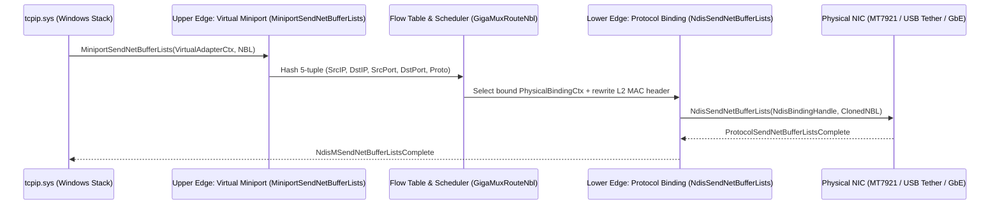

# NDIS 6.x Intermediate MUX Virtual Adapter Design

**Document:** `docs/architecture/NDIS_MUX_DESIGN.md`  
**Isolated Driver Directory:** `Destop/Win/drivers/virtual_wifi_mux/`  
**Status:** `EXPERIMENTAL / OPT-IN KERNEL MODULE` (Not auto-installed by default per Rule 5)

---

## 1. Purpose & Scope

The **WiFi GigaChad 420 NDIS 6.x Intermediate MUX Driver (`gigachadmux.sys`)** is an NDIS 6.80 (`NDIS680`) `NdisMedium802_3` Intermediate Driver that:
1. Exposes an upper-edge Virtual Miniport Adapter named **`WiFi GigaChad 420 Virtual Network`** (`*IfType = 6` / `IF_TYPE_ETHERNET_CSMACD`) to `tcpip.sys`.
2. Binds at its lower-edge as an NDIS Protocol Driver (`NdisRegisterProtocolDriver`) to one or more physical NDIS miniport adapters (`MediaTek Wi-Fi 6 MT7921`, `Realtek PCIe GbE`, `Remote NDIS USB Tether`, `USB Wi-Fi 2`).
3. Provides IOCTL control (`\\.\GigaChadMuxControl`) for user-mode `WifiGigaChad420.exe` to query adapter bindings, inspect packet queues, and update flow weights.

> [!IMPORTANT]
> **Physical vs. Logical Reality (Rule 1 & Rule 2):**  
> An NDIS MUX driver operates at Layer 2 (`NdisMedium802_3` Ethernet frames) above the Native Wi-Fi / WDI layer (`wdiwifi.sys`). It **cannot** create additional 802.11 RF transceivers or force the MediaTek MT7921 firmware (`Max Secondary STAs = 0`) to maintain two simultaneous 802.11 BSSID associations on different channels. Its role is to present a single unified virtual adapter to Windows applications while multiplexing packets across available lower-edge interfaces.

---

## 2. Driver Entry Points & NBL (NET_BUFFER_LIST) Data Path

### Upper-Edge Miniport Handlers (`miniport.c`)
- `MiniportInitializeEx`: Allocates `GIGA_VELAN_ADAPTER`, sets link speed to the sum of active lower-edge bindings, and reports `MediaConnectStateConnected`.
- `MiniportHaltEx`: Drains outstanding `NET_BUFFER_LIST` queues (`KeWaitForSingleObject` on zero refcount) and frees context cleanly.
- `MiniportSendNetBufferLists`: Inspects each `NET_BUFFER_LIST`, hashes the L3/L4 flow tuple, selects the bound lower-edge `GIGA_PROTOCOL_BINDING`, updates the Layer-2 source MAC to the selected physical adapter's hardware MAC (never spoofing external devices), and calls `NdisSendNetBufferLists`.
- `MiniportOidRequest`: Handles `OID_GEN_LINK_STATE`, `OID_GEN_STATISTICS`, and `OID_802_3_CURRENT_ADDRESS`.

### Lower-Edge Protocol Handlers (`protocol.c`)
- `ProtocolBindAdapterEx`: Invoked by NDIS for each physical NIC; opens the lower adapter via `NdisOpenAdapterEx`.
- `ProtocolUnbindAdapterEx`: Cleanly detaches from the physical NIC without disrupting the physical adapter's own TCP/IP stack binding.
- `ProtocolReceiveNetBufferLists`: Receives inbound `NET_BUFFER_LIST` chains from bound physical adapters and indicates them up to `tcpip.sys` via `NdisMIndicateReceiveNetBufferLists`.

---

## 3. Installation, Removal & Rollback Procedure

Because Windows 11 enforces Kernel-Mode Code Signing (KMCS) and HVCI:
1. **Default Application Mode:** `WifiGigaChad420.exe` runs 100% in safe User Mode without loading any unsigned `.sys` driver.
2. **Developer Test-Signing VM / Lab Installation:**
   - Build `Destop/Win/drivers/virtual_wifi_mux/` using Visual Studio 2022 + Windows 11 WDK.
   - Install in a test-signed development environment via `pnputil /add-driver gigachadmux.inf /install`.
3. **Instant Rollback / Removal:**
   - Run `Destop/Win/drivers/virtual_wifi_mux/uninstall_driver.ps1` (or `pnputil /delete-driver gigachadmux.inf /uninstall /force`), which unbinds the MUX protocol edge and deletes the virtual miniport without touching physical adapters.

