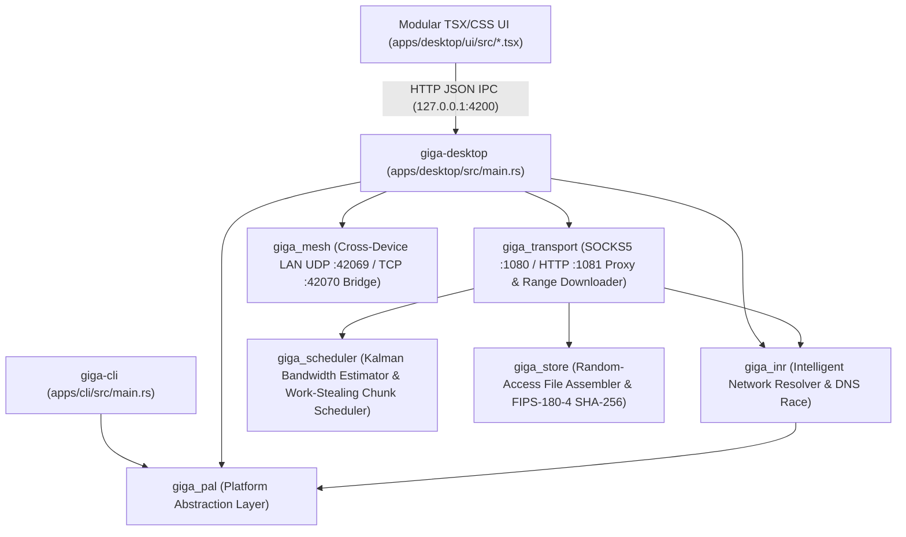

# Phase Zero: Repository Audit — WiFi GigaChad 420

**Audit Date:** 2026-11-03  
**Repository Root:** `D:\Github\LightningMCQueen`  
**Windows Workspace Root:** `D:\Github\LightningMCQueen\Destop\Win` *(Note: `Destop` spelling is intentional in the existing repository layout and is preserved)*  
**Production Binary Target:** `D:\Github\LightningMCQueen\prod\Desktop\win\WifiGigaChad420.exe`

---

## 1. Current Architecture Overview

The **WiFi GigaChad 420** Windows workspace (`Destop/Win/Cargo.toml`) is organized as a multi-crate Rust workspace paired with a zero-dependency TypeScript/React modular UI compiled at `cargo build` time via Node v22 `stripTypeScriptTypes`:

---

## 2. Inventory of Relevant Files & Crates

| Component / Path | Purpose & Current Implementation |
| :--- | :--- |
| `Destop/Win/Cargo.toml` | Workspace manifest defining 6 library crates (`giga_pal`, `giga_inr`, `giga_scheduler`, `giga_store`, `giga_transport`, `giga_mesh`) and 2 binary crates (`apps/cli`, `apps/desktop`). |
| `Destop/Win/crates/giga_pal/src/windows.rs` | Win32 FFI enumeration using `iphlpapi.dll` (`GetAdaptersAddresses`) and `wlanapi.dll` (`WlanOpenHandle`, `WlanEnumInterfaces`, `WlanQueryInterface`) to extract per-interface `if_index`, `LUID`, GUID, MAC, IPv4/IPv6, Gateway, DHCP, DNS, SSID, BSSID, RSSI dBm, PHY mode, and Tx/Rx link speeds. |
| `Destop/Win/crates/giga_pal/src/socket.rs` | Strong-host kernel socket binding via `setsockopt(IPPROTO_IP, IP_UNICAST_IF, if_index.to_be_bytes())` (`0x1F`) + explicit local IPv4 `bind()` prior to `connect()`. |
| `Destop/Win/crates/giga_pal/src/independence.rs` | Verifies true physical WAN independence across adapters by detecting RFC1918/CGNAT hairpins, shared default gateways, and querying external public WAN IPs per bound interface. |
| `Destop/Win/crates/giga_pal/src/os_optimizer.rs` | Configures Windows Connection Manager (`WcmSvc`) `fMinimizeConnections = 0` and `fBlockNonDomain = 0`, equalizes interface metrics (`metric=15`), sets TCP auto-tuning, and manages `HKCU\...\Internet Settings` system proxy. |
| `Destop/Win/crates/giga_inr/src/lib.rs` | Computes Composite Health Score (`CHS` 0–100) from EWMA RTT, jitter, packet loss, and RSSI slope (`d(RSSI)/dt`), plus parallel TCP `:53` and `:443` connection probes. |
| `Destop/Win/crates/giga_inr/src/dns.rs` | Parallel multi-interface UDP/TCP `:53` DNS Race Resolver with lock-free TTL caching. |
| `Destop/Win/crates/giga_scheduler/src/lib.rs` | 1D Kalman Filter bandwidth estimator and work-stealing straggler chunk bisection scheduler. |
| `Destop/Win/crates/giga_store/src/lib.rs` | Sparse random-access file assembler with atomic `.gigachad.part.json` crash recovery journal and native NIST FIPS-180-4 SHA-256 verifier. |
| `Destop/Win/crates/giga_transport/src/downloader.rs` | Multi-path HTTP/1.1 & HTTPS byte-range downloader binding each worker stream to a specific physical NIC (`IP_UNICAST_IF` for HTTP, `curl.exe --interface <ip>` for Schannel HTTPS). |
| `Destop/Win/crates/giga_transport/src/proxy.rs` | Local SOCKS5 (`127.0.0.1:1080`) and HTTP CONNECT (`127.0.0.1:1081`) gateway with 150ms Happy Eyeballs v3 connection hedging across top-ranked interfaces. |
| `Destop/Win/crates/giga_mesh/src/lib.rs` | Cross-device LAN discovery (`UDP :42069`) and TCP relay (`TCP :42070`) for tethering cellular uplinks from a smartphone over common Wi-Fi. |
| `Destop/Win/apps/desktop/src/main.rs` | Unified GUI executable (`#![windows_subsystem = "windows"]`) hosting the local control-plane server, Setup Installer Wizard, Uninstaller Wizard, and Wlan hardware diagnostics. |
| `Destop/Win/apps/desktop/ui/src/` | Modular TSX/CSS frontend (`App.tsx`, `Sidebar.tsx`, `UpdateModal.tsx`, `WifiDashboardScreen.tsx`, `OngoingProcessesScreen.tsx`, `SystemMeshInfoScreen.tsx`, `LogsScreen.tsx`, `InstallerUninstallerScreens.tsx`). |

---

## 3. Specific Audit Questions & Findings

1. **Which networking APIs are already being used?**
   - **Win32 Native FFI (`crates/giga_pal/src/windows.rs`):** `GetAdaptersAddresses` (`iphlpapi.dll`), `WlanOpenHandle`, `WlanEnumInterfaces`, `WlanQueryInterface` (`wlanapi.dll`).
   - **Winsock2 / Tokio (`crates/giga_pal/src/socket.rs`):** `tokio::net::TcpSocket`, `socket2::Socket`, `setsockopt(IPPROTO_IP, IP_UNICAST_IF)`.
   - **Windows CLI Utilities (Diagnostics & Setup only):** `netsh wlan show interfaces`, `netsh wlan show wirelesscapabilities`, `netsh wlan show profiles`, `reg.exe`, and `curl.exe --interface`.
2. **How is adapter enumeration implemented?**
   - Primary telemetry enumeration is implemented in pure Rust Win32 FFI (`GetAdaptersAddresses` + `wlanapi.dll` in `crates/giga_pal/src/windows.rs`) with zero PowerShell overhead.
   - Extended WDI/WiFiCx capability inspection (`Maximum Number of Secondary STAs Supported`) in `apps/desktop/src/main.rs` currently parses `netsh wlan show wirelesscapabilities`.
3. **Does the existing INR have a usable interface abstraction?**
   - Yes: `giga_pal::InterfaceSnapshot` and `giga_inr::HealthScoreSnapshot` provide clean, strongly-typed representations of physical/virtual interfaces. However, `giga_inr` currently lacks explicit **switching hysteresis deadbands** when selecting the primary low-jitter path and does not distinguish virtual interfaces (`WiFi GigaChad 420 Virtual Network`) from physical backing interfaces.
4. **Can the current downloader bind requests to interfaces?**
   - Yes: `MultiPathDownloader` (`crates/giga_transport/src/downloader.rs`) binds raw HTTP sockets via `connect_bound_tcp_v4` (`IP_UNICAST_IF` + `bind()`) and HTTPS streams via `curl.exe --interface <local_ipv4>`. However, it should be enhanced to explicitly record **ETag / Last-Modified headers** and detect servers that return `200 OK` instead of `206 Partial Content` on range probes.
5. **Does the application have administrator-elevation functionality?**
   - Yes: `apps/desktop/build.rs` embeds a Windows UAC `requireAdministrator` manifest when `GIGA_REQUIRE_ADMIN_MANIFEST=1`, and `giga_pal::os_optimizer` also supports on-demand PowerShell `Start-Process -Verb RunAs` elevation.
6. **Does a Windows driver project already exist?**
   - No kernel driver project exists in the repository yet.
7. **Does existing code modify registry networking settings?**
   - Yes: `crates/giga_pal/src/os_optimizer.rs` modifies `WcmSvc` (`fMinimizeConnections = 0`, `fBlockNonDomain = 0`) and `HKCU\Software\Microsoft\Windows\CurrentVersion\Internet Settings` (`ProxyEnable`, `ProxyServer`).
8. **Does the current application have a safe rollback mechanism?**
   - Partial: `set_windows_system_proxy(false, ...)` and `/api/uninstaller-run` reset the user proxy and remove shortcuts, but there is no structured **Transaction & Rollback Snapshot** for `WcmSvc` registry policies, interface metrics, or experimental virtual interface state.

---

## 4. Code That Must Not Be Rewritten / Destroyed

Per Rule 4, the following working subsystems must be preserved intact and extended incrementally:
- `crates/giga_pal` Win32 `GetAdaptersAddresses` + `wlanapi.dll` telemetry and `IP_UNICAST_IF` socket binding.
- `crates/giga_inr`, `crates/giga_scheduler`, `crates/giga_store`, `crates/giga_transport`, and `crates/giga_mesh`.
- Existing 4-screen modular TSX UI (`WifiDashboardScreen.tsx`, `OngoingProcessesScreen.tsx`, `SystemMeshInfoScreen.tsx`, `LogsScreen.tsx`, `InstallerUninstallerScreens.tsx`, `UpdateModal.tsx`, `Sidebar.tsx`).
- Offline-compatible build pipeline (`cargo build --release --offline` + `apps/desktop/ui/bundle.mjs`).

---

## 5. Recommended Integration Points & Identified Technical Debt

1. **New Experimental Subsystem (`Destop/Win/experiments/virtual_wifi/`):**
   - Create an isolated, well-structured Rust module tree (`mod.rs`, `capability_detection.rs`, `adapter_manager.rs`, `connection_manager.rs`, `network_resolver.rs`, `radio_scheduler.rs`, `virtual_interface.rs`, `packet_mapper.rs`, `telemetry.rs`, `diagnostics.rs`) exposed as a workspace crate `giga_virtual_wifi` rooted at `Destop/Win/experiments/virtual_wifi`.
2. **Reversible Configuration Transactions:**
   - Add explicit rollback support so any OS/adapter state change can be cleanly reverted with 1 click.
3. **NDIS 6.x MUX Driver Specification & Isolated Prototype (`Destop/Win/drivers/virtual_wifi_mux/`):**
   - Place the NDIS 6.x Intermediate MUX driver C/INF architecture and user-mode control interface in `Destop/Win/drivers/virtual_wifi_mux/` with strict opt-in/test-signing isolation.
4. **Logs & Diagnostics UI Integration (`LogsScreen.tsx`):**
   - Add the `Experimental Virtual Wi-Fi` panel with honest status badges (`SUPPORTED`, `UNSUPPORTED`, `EXPERIMENTAL`, `UNKNOWN`, `NOT TESTED`, `BLOCKED`), live capability matrix, radio time-sharing experiment runner, and structured event log viewer.

