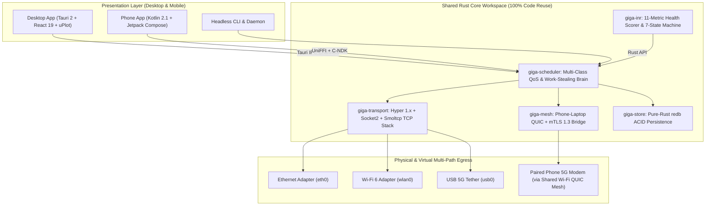
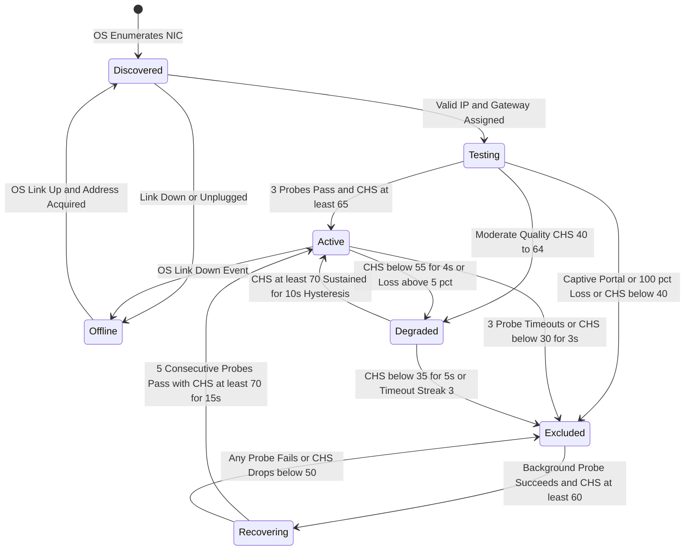
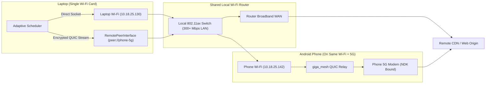

<div align="center">

# WiFi GigaChad 420

### **Multi-Interface Network Aggregation, Intelligent Health Resolver & Cross-Device Mesh Acceleration Engine**

*Eliminate single-adapter operating system routing bottlenecks.*  
*Aggregate **Ethernet, Wi-Fi 6, 5G USB, and Paired Mobile Phone 5G over Shared Wi-Fi** into a unified, self-healing bandwidth pipeline.*

[](./LICENSE)
[](https://www.rust-lang.org/)
[](https://v2.tauri.app/)
[](https://developer.android.com/jetpack/compose)
[](./Docs/WiFi_GigaChad_420_Plan.md)
[](./Docs/WiFi_GigaChad_420_Plan.md)
[](./CONTRIBUTING.md)

---

[**Master Engineering Blueprint**](./Docs/WiFi_GigaChad_420_Plan.md) | [**Intelligent Network Resolver (INR)**](#intelligent-network-resolver-inr--auto-exclusion) | [**Phone-to-Laptop Wi-Fi Mesh**](#cross-device-phone--laptop-wi-fi-mesh-giga_mesh) | [**Tech Stack**](#modular-future-proof-tech-stack) | [**Contributing**](./CONTRIBUTING.md) | [**Security**](./SECURITY.md)

</div>

---

## Problem Statement

Standard operating systems (Windows, Linux, macOS, Android) route all outbound internet traffic through a **single default gateway** determined by static administrative metrics. Even when a host possesses multiple operational network adapters (e.g., Gigabit Ethernet, onboard Wi-Fi, and a 5G mobile device):

1. **Unutilized Bandwidth:** Secondary and tertiary network interfaces remain idle at 0% utilization during standard transfers.
2. **"Zombie Wi-Fi" Blackholes:** If a Wi-Fi access point broadcasts a strong physical signal (`-45 dBm`) while its upstream ISP link is degraded or disconnected, the OS continues routing traffic into the dead gateway rather than failing over to a working cellular or secondary link.
3. **The Mobile Hotspot Catch-22:** Enabling a mobile phone's native Wi-Fi Hotspot forces the phone to disconnect from the local Wi-Fi router, preventing simultaneous utilization of the router's broadband WAN and the phone's 5G cellular connection without a physical USB tether.

**WiFi GigaChad 420** addresses these limitations through a modular, pure-Rust user-space networking engine shared across **Desktop (Windows, Linux, macOS)** and **Mobile (Android)**.

---

## Core Capabilities

| Capability | Technical Summary |
| :--- | :--- |
| **Multi-Interface Segmented Acceleration** | Partitions large HTTP/HTTPS transfers (RFC 9110 `Range: bytes=X-Y`), adaptive video segments (HLS/DASH), and software packages across all healthy interfaces concurrently via explicit per-socket binding (`socket2`, `IP_UNICAST_IF`, `SO_BINDTODEVICE`, Android C-NDK `android_setsocknetwork`). |
| **Intelligent Network Resolver (INR)** | Continuously evaluates every network interface (`CHS 0–100`) across **11 dimensions**: upstream WAN reachability, captive portal status, bound DNS latency, RTT, jitter, packet loss, empirical goodput EMA, bufferbloat (`ΔRTT`), link stability, metered budgets, and Wi-Fi RSSI. |
| **7-State Machine & Zero-Loss Failover** | Automatically transitions degraded or unreachable links to `Excluded` within `≤ 3.0s`. Preserves `100%` of flushed 256 KiB disk blocks, splits in-flight byte ranges, and reassigns remaining segments to healthy links with hysteresis anti-flap protection. |
| **System-Wide Internet Optimization** | Extends multi-interface routing to web browsing, API requests, streaming, and desktop/mobile applications via **Multi-Interface Parallel DNS (`hickory-resolver`)**, **Local HTTP/SOCKS5 Loopback Proxy**, and **Virtual TUN (`WinTun`, `tun-rs`, Android `VpnService` + `smoltcp`)** with TLS SNI Domain Affinity. |
| **Cross-Device Phone ↔ Laptop Wi-Fi Mesh** | Bridges a Phone and Laptop over a **single shared Wi-Fi network** using mDNS discovery and encrypted **QUIC (`iroh` / `quinn`)**. Enables the Laptop to aggregate the local Wi-Fi router's WAN and the Phone's 5G cellular connection wirelessly at the same time. |
| **Zero-Copy Sparse Disk Engine** | Pre-allocates target files (`fallocate` / `SetFileInformationByHandle`) and executes concurrent, lock-free positional disk writes (`pwrite`) with streaming SIMD **SHA-256 and BLAKE3** cryptographic verification. |
| **Windows TCP "Crack Mode" Optimizer** | Uncaps Windows multimedia network throttling (`NetworkThrottlingIndex = 0xFFFFFFFF`), eliminates Nagle's 40ms delayed ACK buffering (`TCPNoDelay = 1`), and activates BBR / CTCP congestion control. |
| **Plug & Play Multi-Link Aggregator** | Immediately detects secondary network paths (Phone USB Tethering, Ethernet, USB Wi-Fi dongles), equalizes routing metrics (`metric=15`), and stripes socket streams across all paths concurrently. |

---

## Windows Production Executable

The production Windows single-file executable is packaged and deployed at:
`prod/Desktop/win/WifiGigaChad420.exe`

- **Single Portable File:** All native Rust transport workers, INR health state machine, and GUI assets are bundled into one standalone binary.
- **Zero-CLI Popup Subsystem:** Compiled with `#![windows_subsystem = "windows"]` to run as a clean desktop window without flashing command-line consoles.
- **Embedded Administrator Manifest:** UAC elevation (`requireAdministrator`) is embedded directly in the binary manifest for kernel socket binding and OS network optimization.
- **Windows TCP Crack Mode:** 1-click optimization of the Windows TCP/IP stack to eliminate packet delays and uncap multimedia throttling.
- **Real-Time NDIS Telemetry:** 100% genuine hardware byte sampling directly from Windows kernel NDIS (`GetIfEntry2`).
- **Turbo Downloader:** 16-worker parallel range downloader built into the control center.

---

## System Architecture



---

## Intelligent Network Resolver (INR) & Auto-Exclusion

WiFi GigaChad 420 **decouples physical signal strength from internet usability**. An access point with `-42 dBm` RSSI (full signal bars) and a disconnected upstream WAN is immediately quarantined as `Excluded`, whereas a `-81 dBm` cellular or secondary Wi-Fi link with `24 ms` RTT and `0%` packet loss remains `Active`.



### Composite Health Score (`CHS`) Formulation
Every eligible interface `i` is evaluated on a normalized scale `S_i ∈ [0, 100]`:

```text
S_i = 0.30 * Φ_loss(L_i)
    + 0.20 * Φ_rtt(RTT_i, J_i)
    + 0.20 * Φ_tput(B_i)
    + 0.15 * Φ_stab(σ_i, F_i)
    + 0.10 * Φ_cong(ΔRTT_i)
    + 0.05 * Φ_wifi(RSSI_i)
```

---

## Cross-Device Phone ↔ Laptop Wi-Fi Mesh (`giga_mesh`)

When a Laptop with a single Wi-Fi adapter and a Mobile Phone are connected to the same residential or campus Wi-Fi network, `giga_mesh` bonds both devices without requiring USB cables or disconnecting the Phone from Wi-Fi:



1. **Zero-Config Discovery:** Laptop and Phone discover each other on the shared Wi-Fi subnet via mDNS (`mdns-sd`) or QR code pairing (with **Wi-Fi Direct** fallback for enterprise networks with AP Client Isolation).
2. **Simultaneous Wi-Fi + 5G Operation:** Using Android's `ConnectivityManager` and C-NDK `android_setsocknetwork()`, the Phone remains associated with the local Wi-Fi router while keeping its **5G cellular modem** active and routable.
3. **Multiplexed QUIC Relay:** The Laptop dispatches byte-range requests over the local Wi-Fi LAN (at 300+ Mbps, 1–2 ms latency) to the Phone, which fetches the segments over **5G** and streams them back to the Laptop over **mTLS 1.3 QUIC (`iroh` / `quinn`)**.

---

## Mathematical Acceleration Model

Consider a **10 GB** (`10,000 MB`) payload transferred across three independent paths:

| Interface | Medium | Goodput (`B_i`) | RTT | Scheduler Allocation (`R_i`) |
| :--- | :--- | :--- | :--- | :--- |
| **`eth0`** | Gigabit Fiber LAN | `200 Mbps` (25.0 MB/s) | 12 ms | **57.1%** (~5.71 GB) |
| **`wlan0`** | 5 GHz Wi-Fi 6 | `100 Mbps` (12.5 MB/s) | 28 ms | **28.6%** (~2.86 GB) |
| **`peer://phone-5g`** | 5G Mesh / USB | `50 Mbps` (6.25 MB/s) | 45 ms | **14.3%** (~1.43 GB) |
| **Combined Pool** | **3 Independent WANs** | **`350 Mbps` (43.75 MB/s)** | **Adaptive** | **100% (~3.8 mins vs 13.3 mins on Wi-Fi alone)** |

---

## Modular, Future-Proof Tech Stack

### 1. Shared Rust Core Workspace (`crates/`)
- **Async Runtime:** `tokio` (`rt-multi-thread`) + `bytes` (zero-copy reference-counted buffers)
- **HTTP & Custom Socket Connector:** `hyper` 1.x + `tokio-rustls` (`aws-lc-rs`) + `socket2`
- **Per-Interface Smart DNS:** `hickory-resolver` (bound UDP/TCP/DoH/DoT parallel hedging)
- **System-Wide Capture & User-Space TCP:** `smoltcp` + `tun-rs` / `wintun` + `fast-socks5` + Linux `aya` (Pure-Rust eBPF)
- **Cross-Device Mesh:** `iroh` / `quinn` (QUIC + mTLS 1.3) + `mdns-sd` + `postcard`
- **ACID Persistence:** `redb` + `rkyv` (100% pure Rust, zero C cross-compilation dependencies) + optional `sqlx` (SQLite)
- **Integrity:** SIMD `sha2` (SHA-256) + `blake3`

### 2. Desktop Application (`apps/desktop/`)
- **Framework:** **Tauri 2.x** (~35 MB RAM footprint, binary IPC channels)
- **UI Stack:** **React 19 + TypeScript 5 + Vite 6 + Tailwind CSS v4 + Shadcn UI**
- **State & 60 FPS Telemetry:** **Zustand** + **`uPlot`** + **HTML5 `OffscreenCanvas`** ("GigaMap" live chunk grid)

### 3. Mobile Application (`apps/android/`)
- **UI Stack:** **Kotlin 2.1 + Jetpack Compose (Material 3, KMP-ready)**
- **Architecture:** MVI + Kotlin Coroutines / `StateFlow` + `Hilt`
- **Native Interop & OS Networking:** **Mozilla `UniFFI`** + Android C-NDK (`android_setsocknetwork`) + `ConnectivityManager` + `VpnService` + `WifiP2pManager`

---

## Monorepo Structure

```text
WifiGigaChad420/
├── Cargo.toml                     # Root Rust workspace definition
├── Docs/
│   └── WiFi_GigaChad_420_Plan.md  # Full 2,300+ line Master Engineering Specification
├── crates/
│   ├── giga_pal/                  # Platform Abstraction Layer (WinSock, Netlink, eBPF, Android NDK)
│   ├── giga_inr/                  # Intelligent Network Resolver & 7-State Machine
│   ├── giga_scheduler/            # Multi-Class QoS & Work-Stealing Scheduler Brain
│   ├── giga_transport/            # Hyper + Socket2 Workers, Local Proxy & Smoltcp TUN Stack
│   ├── giga_mesh/                 # Cross-Device Phone <-> Laptop QUIC Mesh Engine
│   ├── giga_store/                # Pure-Rust redb ACID State Store
│   └── giga_ffi/                  # UniFFI bindings for Android / iOS
├── apps/
│   ├── desktop/                   # Tauri 2 + React 19 Desktop App (Windows, Linux, macOS)
│   ├── android/                   # Kotlin 2.1 + Jetpack Compose Android App
│   └── cli/                       # Headless CLI & Daemon
├── CONTRIBUTING.md                # Developer setup & contribution guide
├── CODE_OF_CONDUCT.md             # Community standards
├── SECURITY.md                    # Security policy & threat model
└── LICENSE                        # GNU GPL v3.0
```

---

## Development Roadmap

- [x] **Phase 0:** Master Engineering Blueprint, Mathematical Models & Architecture Specification ([WiFi_GigaChad_420_Plan.md](./Docs/WiFi_GigaChad_420_Plan.md))
- [ ] **Phase 1:** `giga_pal` & `giga_transport` — Cross-platform per-socket NIC binding & RFC 9110 segmented HTTP engine
- [ ] **Phase 2:** `giga_inr` & `giga_scheduler` — 11-metric Intelligent Network Resolver, 7-state hysteresis FSM & zero-loss chunk splitting
- [ ] **Phase 3:** `apps/desktop` — Tauri 2 + React 19 + `uPlot` + `OffscreenCanvas` GigaMap visualizer (Windows & Linux)
- [ ] **Phase 4:** `apps/android` — Kotlin 2.1 + Jetpack Compose + NDK simultaneous Wi-Fi & 5G acceleration
- [ ] **Phase 5:** System-Wide Optimization — Local HTTP/SOCKS5 proxy, Browser Native Messaging extension, Parallel DNS & Android `VpnService`
- [ ] **Phase 6:** `giga_mesh` — Wireless Phone ↔ Laptop 5G-over-Wi-Fi QUIC Mesh & P2P LAN swarming
- [ ] **Phase 7:** Kernel & Cloud Bonding — Windows WinTun/WFP, Linux `aya` eBPF & optional remote VPS multipath aggregator

---

## Documentation & Governance

* **Technical Specification:** [Docs/WiFi_GigaChad_420_Plan.md](./Docs/WiFi_GigaChad_420_Plan.md)
* **Contribution Guidelines:** [CONTRIBUTING.md](./CONTRIBUTING.md)
* **Code of Conduct:** [CODE_OF_CONDUCT.md](./CODE_OF_CONDUCT.md)
* **Security Policy & Threat Model:** [SECURITY.md](./SECURITY.md)

---

## License

Distributed under the **GNU General Public License v3.0 (GPL-3.0)**. See [LICENSE](./LICENSE) for full details.

<div align="center">
  <sub>Engineered in Rust by <a href="https://github.com/cubicreates">@cubicreates</a>.</sub>
</div>
